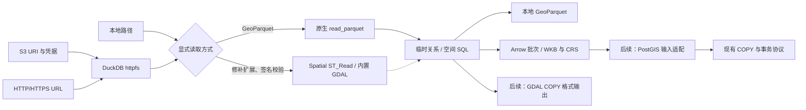

# DuckDB 矢量计算集成设计

日期：2026-11-17。仓库基线：`49c642410326eae115faf47e13abe71b700ae006`。

状态：整体方案已获确认。GeoParquet 闭环与 GDAL 多格式 reader 已实现；修补并签名的 Spatial 扩展解决上游错误传播缺陷；实际边界与使用方式以 [已实现接口](DUCKDB.md) 为准，验收证据与未测范围单列于 [验证记录](DUCKDB_VALIDATION.md)。后续阶段的类型化算子、PostGIS 流式桥接、性能优化仍为规划，不能当作现有能力。

## 1. 建议与边界

新增可选的 `spatial_core::duckdb` 模块，将 DuckDB 用作嵌入式矢量分析引擎。GeoParquet 使用原生 Parquet reader；其他矢量格式使用修补扩展中的 `ST_Read`，启用要求显式公钥和原生补丁契约。计算尽量在 DuckDB 内完成，结果以 GeoParquet 或 Arrow 批次交付。

| 现有或新增模块 | 职责 | 集成后的关系 |
| --- | --- | --- |
| `raster` / GDAL | 栅格读取、Warp、DEM、Rasterize、Polygonize 等 | 保留现有实现；栅格转矢量的结果可再进入 DuckDB |
| `vector` / GDAL | 格式转换、驱动选项、现有几何处理 | 保留 API 和默认语义；也可显式预处理 DuckDB 缺少驱动的输入 |
| 新增 `duckdb` | 文件上的关系查询、空间连接、几何计算、分组聚合 | 适合跨文件、跨格式的矢量分析 |
| `postgis` | 事务写入、目标 schema、CRS 校验和数据库元数据 | 继续承担持久化；后续接入 DuckDB 结果流 |

现有 `postgis` 是导入及元数据适配器，并没有通用 PostGIS SQL 算子执行接口；本次不把数据库的全部函数包装进库。算子注册、业务资源解析、HTTP、DAG、调度和重试仍由上层负责，符合 [README](../README.md) 与 [提取边界](EXTRACTION.md)。

不先建立 GDAL/DuckDB/PostGIS 的统一引擎 trait、自动选路器或 SQL DSL。调用方显式选择后端，不同后端的 CRS、空值、精度和失败语义不应通过自动回退被改变。



## 2. 已核对的版本与能力

候选基线为 DuckDB **2.0 LTS**，选择匹配的 Rust binding、`spatial`、`httpfs` 和平台构件。2026-11-17 查阅的 Rust 已发布 API 文档标为 `duckdb 1.20000.2`；阶段 0 应核实实际引擎版本并锁定依赖，不能把 crate 版本号直接当作引擎版本号。当前仓库的 Rust/GDAL 构建约束继续适用。

- `GEOMETRY` 自 DuckDB 1.5 起成为核心类型，可携带列级 CRS；空间算法仍主要由 `spatial` 提供。新设计保留 CRS 类型信息，不沿用旧版“DuckDB 几何没有 CRS”的假设。[Geometry 文档](https://duckdb.org/docs/2.0/sql/data_types/geometry)
- Spatial 自带 GDAL，与本项目链接的系统 GDAL 是两套能力集合；必须分别探测驱动。Spatial 的 GDAL 集成只处理矢量，`COPY ... FORMAT GDAL` 可导出受支持格式，`SRS` 选项只设置标签。[GDAL 集成](https://duckdb.org/docs/2.0/core_extensions/spatial/gdal)
- `ST_Read` 提供 layer、driver、open options、伴随文件及空间过滤参数；默认取第一层，读取不能充分利用多线程。[Spatial 函数](https://duckdb.org/docs/2.0/core_extensions/spatial/functions#st_read)
- `httpfs` 支持 HTTP(S) 读取及 S3 读取、列举、写入。HTTP Parquet 可利用 Range 请求和列裁剪；普通 HTTP 没有通用目录列举能力。[HTTP(S)](https://duckdb.org/docs/2.0/core_extensions/httpfs/https)、[S3](https://duckdb.org/docs/2.0/core_extensions/httpfs/s3api)
- 上游当前源码通过 DuckDB 文件系统桥接 GDAL；显式 `/vsi...` 路径会绕过该桥接。这个源码观察不是对选定发布构件的验证，阶段 0 要实测远端路径。[上游 GDAL 模块](https://github.com/duckdb/duckdb-spatial/blob/main/src/spatial/modules/gdal/gdal_module.cpp)

## 3. 输入设计

### 3.1 格式和存储分别建模

拟议的 `duckdb::VectorSource` 包含位置、读取方式和读取选项。位置区分本地 `PathBuf` 与远端 URL/URI；读取方式先只有 `GeoParquet` 和 `Gdal`。CSV/JSON 表格可后续直接使用 DuckDB 原生 reader，再显式从 XY/WKT/WKB 生成几何。

现有 `dataset::Source` 带有 GDAL connection name/VSI 语义，`postgis::vector::VectorSource` 又包含 GDAL 线程配置，因此本轮不重写这两个类型。新增来源不自动继承它们的配置。对于无法无损传给 DuckDB 的非 UTF-8 本地路径，明确报不支持，不能 `to_string_lossy()` 后读取另一条路径。

| 格式 | 读取入口 | 本地 | S3 / HTTP(S) 的设计承诺 |
| --- | --- | --- | --- |
| GeoParquet | `read_parquet` | 首期必测 | 首期必测；优先列裁剪、属性过滤及经过验证的空间统计过滤 |
| FlatGeobuf | `ST_Read` | 首期必测 | 首期必测；空间索引、Range 和过滤下推效果按实际构件验证 |
| GeoJSON | `ST_Read` | 首期必测 | 首期必测；可能顺序读取大量数据，不承诺局部随机访问 |
| GeoPackage | `ST_Read`，明确 layer | 首期必测 | 验证随机读取；不适合直接读的构件/端点采用显式本地暂存 |
| Shapefile | `ST_Read` | 首期必测 `.shp/.shx/.dbf` 及可选 `.prj/.cpg` | 显式提供伴随文件；普通 HTTP 不依赖目录发现，必要时整组暂存 |
| ZIP 内矢量 | 暂存后 `ST_Read`，必要时本机 GDAL 转换 | 按驱动和归档成员验证 | 首期不承诺任意嵌套远程 VSI；下载完整归档后走同一读取入口 |
| FileGDB、KML、GML、其他 OGR 格式 | `ST_Read` + `ST_Drivers()` | 驱动存在才支持 | 格式 × 协议逐项登记；缺驱动时显式用现有 GDAL 转成已支持格式 |

“支持 GDAL 格式”不等于支持本机所有 GDAL 驱动，也不等于每个格式都可高效远程读取。目录型数据集和多文件格式必须明确文件集合。暂存策略由调用方选择并提供目录及容量预算，失败不能偷偷全量下载；首期可以由调用方完成暂存，不再新增通用下载框架。

### 3.2 来源解析和 metadata

1. `inspect(source)` 使用 Parquet schema/`geo` metadata，或 `ST_Read_Meta`，返回字段、几何列、CRS、维度、图层与可获得的统计量。未知行数/范围保留为 `None`，不为获得计数强制完整扫描。
2. 多图层输入要求明确选择；多几何列保留 metadata，处理 API 要求选定操作列。禁止隐式取第一层、第一列或把所有几何都重命名为 `geom`。
3. `register(alias, source)` 建立临时 view/relation，避免默认先复制整份数据。构造来源对象不做 I/O；inspect/register 可能读取远端 footer 或绑定 GDAL schema。
4. 支持显式文件列表；本地/S3 glob 需限制展开数量并核对各文件 schema、CRS、编码。S3 glob 需要列举权限；HTTP 输入通过明确 URL 列表处理。schema 不一致默认拒绝，不隐式 `union_by_name`、补 NULL 或猜测 CRS。
5. `spatial_filter_box` 和可用的 bbox 统计仅作候选裁剪；需要精确空间关系时保留最终谓词复核。跨日期变更线的范围不得当作普通平面 min/max 直接裁掉。

### 3.3 凭据和远端 I/O

新模块接受显式 S3/HTTP 访问配置。阶段 0/1 支持 S3 endpoint、region、URL style、静态 access key/secret，以及公开 URL、预签名 HTTPS URL 和单一 HTTP Authorization header。固定 httpfs 的跨源重定向会转发自定义 header/S3 session token，因此当前拒绝这些配置；完整临时凭据与自定义 header 支持须先有经过验证的原生重定向策略。凭据链留待后续显式选择并核对 `aws` 扩展。保留签名 URL 的查询参数，日志仅输出脱敏来源；创建 secret 的 SQL、绑定值及原生错误也不得泄露凭据。

首期每个 Session 独占 DuckDB instance 与连接，使用临时、带路径 scope 的 secret。2.0 的 `IN connection` 存储也可显式使用；普通临时 secret 的寿命属于 instance，不能把 `try_clone()` 当作隔离。禁用隐式读取用户的持久 secret、自动持久化凭据和网络安装扩展。scope 是凭据选择规则，不是资源授权机制。[Secrets Manager](https://duckdb.org/docs/2.0/configuration/secrets_manager)

DuckDB 的 S3 secret 与 `GdalOptions` 分开配置；不假定设置系统 GDAL 的 AWS 选项会影响 Spatial 内置 GDAL。优先将原始 `s3://`、`https://` 交给 DuckDB，不批量改写成 `/vsis3/`、`/vsicurl/`。

设置有限连接/请求超时和重试次数；证书校验保持开启。401/403、缺 Range、对象截断和中途读取失败必须报告为错误，不能变成正常 EOF。多次读取要求来源在作业期间稳定；跨多个可变远端文件不宣称有事务快照，需复现时由调用方固定版本或物化一次。

## 4. 计算入口与算子范围

提供一个参数化查询通路；常用处理在同一通路上加少量类型化方法，不为每个 `ST_*` 都创建 wrapper，也不复制一套 SQL 优化器。多个处理通过 CTE/view 组合，只有复用、索引或资源需要时才物化临时表。

| 能力 | 实现方式 | 必须明确的语义 |
| --- | --- | --- |
| 属性/范围筛选、字段投影和计算 | `SELECT`、`WHERE`、表达式 | 参数绑定；别名/字段名正确引用；不隐式排序 |
| 重投影 | `ST_Transform` | 输入 CRS、目标 CRS、轴顺序；改标签与重投影分开 |
| Buffer、简化、质心、凸包 | 相应 Spatial 函数 | 距离单位、输出几何类型、Z/M 是否保留 |
| Clip / Intersection | 精确空间 join 后 `ST_Intersection` | 按掩膜要素输出或先融合掩膜；重叠掩膜可能产生多行 |
| Erase / Difference | 候选掩膜聚合后 `ST_Difference` | 对每个源要素减去整个相关掩膜，不能逐对相减后直接拼接 |
| Dissolve | 分组 + `ST_Union_Agg` | 分组键、其他字段聚合规则、空组/NULL 和资源预算 |
| SpatialJoin | `JOIN ... ON ST_Intersects/Within/...` | inner/left、边界规则、一对多与多对多、重复字段和来源 ID |
| 空间统计 | 空间 join + `GROUP BY` | 未匹配对象是否保留；`count(*)` 与 `count(匹配ID)` 的区别 |
| 几何检查/修复/拆分 | 显式 valid/repair/dump 处理 | 默认失败，不自动修复、降维或丢弃要素；拆分保留来源标识 |
| 最近邻、距离匹配 | 距离计算 + 经过验证的候选集/排序 | 后续阶段；先保证正确性，不以固定 bbox 近似冒充全局最近邻 |
| 格式输出 | 原生 Parquet COPY / 后续 GDAL COPY | schema、几何、CRS、格式限制及输出完成状态 |

首批类型化处理建议只做 **Filter、Reproject、Buffer、Clip、SpatialJoin、Dissolve**；其他能力先通过受信任的参数化 SQL 组合。`ST_Union` 是几何集合运算，不等于保留双方属性、切分全部区域的 GIS Union Overlay；后者需要单独定义属性和行数语义。[Spatial 函数索引](https://duckdb.org/docs/2.0/core_extensions/spatial/functions)

空间连接应检查 `EXPLAIN` 中的执行策略。已有临时 R-tree 的 `SPATIAL_JOIN` 优化，但不为任意查询形状保证命中，也不因配置了临时目录就保证任意空间连接能溢写。2025 年官方说明中的 build-side 内存限制应在目标 2.0 构件重测；本地 R-tree 索引和远端 Parquet 的过滤下推是不同机制。[空间连接说明](https://duckdb.org/2025/08/08/spatial-joins)、[R-tree](https://duckdb.org/docs/2.0/core_extensions/spatial/r-tree_indexes)

下面仅展示已经将输入登记为 `points` / `regions`，且两者 CRS 一致后的“按行政区统计点数”；边界采用 `ST_Intersects`，边界点可以匹配多个区域：

```sql
SELECT r.region_id, count(p.point_id) AS point_count
FROM regions AS r
LEFT JOIN points AS p ON ST_Intersects(r.geom, p.geom)
GROUP BY r.region_id;
```

实际接口应要求 `point_id` 非 NULL 或使用单独的非空匹配标记，不能把属性 NULL 误当作未匹配。

## 5. 数据契约

### CRS、维度与精度

- Session 显式设置 `geometry_always_xy = true`，在库边界采用 x=经度/easting、y=纬度/northing；原始坐标按来源规范解释。2.0 对相关算法要求明确选择此设置，不依赖版本默认值。[轴顺序迁移](https://duckdb.org/2026/03/09/announcing-duckdb-150)
- 优先使用带 CRS 的 `GEOMETRY` 类型，同时保存几何列的完整定义。未知 CRS 可做 metadata 检查和属性筛选；首期类型化空间计算要求明确 CRS，不开启 `ignore_unknown_crs` 静默丢标签。双输入运算先验证 CRS 一致；转换由调用方明确指定。
- GeoParquet 1.x 中，省略 `crs` 表示默认 OGC:CRS84，`crs: null` 表示未知，二者不同；还应检查 `encoding`、`edges`、`epoch`。球面边或动态 CRS 不能悄悄用普通平面算法解释；首期未验证组合返回不支持。[GeoParquet 1.1 规范](https://geoparquet.org/releases/v1.1.0/)
- 平面 buffer/distance/area 使用坐标单位。米制计算要求合适的投影或明确的球面/椭球算法；不默认把所有数据投到 EPSG:3857。栅格 Warp 与 DuckDB Transform 的 PROJ 构件及格网能力分别验证。
- 区分 NULL、EMPTY、无效几何和零行数据；不默认 make-valid、force-2D 或 skip-errors。首批几何算法以 XY 为验收基线，XYZ/XYM/XYZM 按算子建立保留/拒绝规则；支持读取某种维度不代表所有算法保留它。
- 字段沿用 Arrow/DuckDB 类型，不先转 JSON/字符串集合。整数、decimal、timestamp、时区、二进制、list/struct 的映射须明确；decimal 不经过 f64。DuckDB/Arrow 的范围不能代表 PostgreSQL 全部 numeric 或 timestamp 范围，超范围和精度下降必须拒绝或显式转换。
- 输出行顺序、FID 和 join 后唯一性默认不承诺；需要稳定顺序或业务 ID 时由调用方显式声明。类型化算子保留来源 ID，输出 schema 变化可检查。

### GeoParquet 输出

使用原生 `COPY ... (FORMAT PARQUET, ...)`，让结果几何保持 `GEOMETRY` 类型并携带 CRS。不能先转普通 BLOB 再把生成的 Parquet 宣称为 GeoParquet。

原方案优先考虑 `GEOPARQUET_VERSION 'V1'`，但阶段 0 实测发现 2.0 自动 metadata 会遗漏全 NULL 几何列和未知 CRS。实现改用原生 Parquet COPY + 标准 WKB + 显式 GeoParquet 1.1 `geo` metadata，逐列保留 CRS（未知为 null），并读回核对字段类型、全部几何列与 CRS；不输出没有 geometry metadata 的普通 BLOB Parquet。`geometry_types: []` 按规范表示未知，暂不计算 bbox。V2/BOTH 后续按消费者能力开启。[COPY 选项](https://duckdb.org/docs/2.0/sql/statements/copy)

GeoParquet 1.1 的标准几何编码只覆盖 XY/XYZ，不能把 XYM/XYZM 无损导出作为 V1 承诺；这类输入明确拒绝该输出，或由调用方显式转换/选择另一目标。多几何列、空文件、非默认 CRS 和 GeoArrow 编码输入单独验证，不假定 DuckDB 可读取所有 GeoParquet 编码。

第一阶段只输出本地文件和 Arrow；用户要求的 S3/HTTP **读取**独立成立。S3 结果发布后续采用唯一对象 key/清单，另定义覆盖与失败契约；普通 HTTP 不提供输出接口。

## 6. Rust 接口与执行生命周期

拟议接口控制在以下范围，最终名称以概念验证为准：

| 接口 | 作用 |
| --- | --- |
| `duckdb::Session::open(config)` | 创建独立 instance/connection，加载预置扩展，设置资源/凭据/轴顺序 |
| `session.capabilities()` | 引擎和扩展版本、可用驱动及读写能力，供调用方预检 |
| `session.inspect(&source)` | 读取 metadata，不为了统计量扫描全部要素 |
| `session.register(name, source)` | 登记受控临时关系，返回实际 schema/几何列描述 |
| `session.query(sql, params)` | 创建借用 Session 的查询；不提前收集结果 |
| `query.for_each_batch(control, callback)` | 在执行线程逐批交付 Arrow 数据，回调错误/取消立即停止 |
| `query.write_geoparquet(path, options, control)` | 新建本地 GeoParquet，完成关闭及必要输出核对后返回报告 |

先采用批次回调消费，避免返回自引用的 Connection/Statement/Iterator 组合；Arrow 使用 duckdb-rs 对应版本的类型，不另加 Polars/DataFusion。跨后端边界使用标准 WKB + 独立 CRS/schema 描述，不传 DuckDB 内部 geometry 字节。类型化处理按操作传播 metadata；高级 SQL 的结果以实际逻辑类型核对，无法确定几何/CRS 时要求显式输出契约，不能照搬输入 metadata。

duckdb-rs 的 `Connection` 可移动但不能并发共享，`Statement` 也不能跨线程。Session 在调用方的 blocking 线程执行，一次一条活跃查询；库不再创建 async 查询框架或全局池。现有取消 token 复用 `control::Cancellation`；查询控制/进度使用本模块类型，以阶段、已输出行数和可选百分比表示，避免硬套 GDAL 的必填 fraction。[Connection](https://docs.rs/duckdb/1.20000.2/duckdb/struct.Connection.html)

读取大结果使用 `Statement::stream_arrow` 对应的流式路径；`query_arrow` 会在执行时物化结果，不能因为按 RecordBatch 迭代就称其为流式。必须处理每批 fetch/Arrow 转换失败，最终成功依赖整条查询完成；中间批次交付不等于结果已提交。[Statement](https://docs.rs/duckdb/1.20000.2/duckdb/struct.Statement.html)

取消通过该连接的 `InterruptHandle` 传递，包括仍在执行首个 batch 前的查询。需要监视 token 时，采用作业内受控的监听生命周期，任务结束先停监听再复用连接；不能让旧作业的迟到取消打断下一条查询。异步调用方取消后仍需等待 blocking 工作退出。原生驱动/网络 I/O 的中断延迟由实测决定，不承诺硬实时停止。

`memory_limit`、`threads`、独占临时目录、临时磁盘预算由 Session config 明确提供；另限制输出行/字节和来源数量。流式消费不消除排序、聚合、空间连接的内部物化；`memory_limit` 不是进程 RSS 硬上限。[资源限制](https://duckdb.org/docs/2.0/operations_manual/limits)

错误至少区分输入/schema/CRS、缺扩展或驱动、远端读取、查询、资源不足、取消、写入/发布和清理失败。复用现有“主错误与清理错误分别保留”的行为，但不强塞入依赖 CPL error number 的 GDAL 诊断结构。

SQL 值尽量绑定；关系名、字段名、COPY/DDL 等无法绑定的位置集中校验和引用。高级 SQL 仅接受受信任调用方输入，不宣称“以 SELECT 开头”就是沙箱；租户鉴权和不可信 SQL 执行隔离留在服务层。

## 7. 与现有输出及 PostGIS 的衔接

本地单文件输出默认不覆盖已有目标。先写同一文件系统上的独占临时位置，关闭并检查后以不覆盖语义发布；可复用现有 `tempfile`，不要用普通覆盖式 rename 绕过目标保护。发布前失败清理本作业临时文件，清理失败独立报告；输入与输出别名/硬链接保护沿用现有契约。多文件格式需独占目录，不承诺任意目录发布的原子性。

PostGIS 分两步接入：

1. **首期可组合路径**：DuckDB 输出本地 GeoParquet，再交现有 `PostGisVectorWriter`。此路径要求系统 GDAL 的 Parquet driver，且受现有 OGR 字段映射范围限制；不能把它称为通用无损 Arrow→PostGIS 路径。需要中间格式时按 schema 选择并验证，不能用 GeoJSON/GPKG 默默规避 decimal/时间精度要求。
2. **正式流式桥接**：新增受 feature 控制的 DuckDB 来源入口，在既有 `SourceStream` worker 内逐批读取并编码，再复用 `transaction::write`、目标规划、COPY、最终验证和 COMMIT。保留原 `write(VectorSource, ...)`；不通过 DuckDB postgres 扩展创建另一套入库事务。

桥接的具体改动限于新来源及必要的共享字段编码，不重写事务协议。重点保持 [当前设计](POSTGIS_REFACTOR.md) 的背压、字段精度、目标 SRID 定义校验、空源策略、失败回滚、取消后 await、`CommitOutcomeUnknown`。当前 PostgreSQL schema 仅接受一个主几何列及规定几何类型，DuckDB 的 GeometryCollection/多几何列结果必须显式选择、拆分或拒绝。

若后续需要从 PostGIS 参与 DuckDB 分析，再单独增加只读来源，明确 WKB、CRS、过滤下推和快照边界；本轮不扩张为跨数据库事务系统。

## 8. 构建、文件范围与兼容性

新增 opt-in `duckdb` Cargo feature；默认依赖和现有 GDAL/PostGIS 行为保持原状。首期验证 `duckdb-rs` 的 bundled 构建路线；bundled core 不代表已经包含 Spatial/httpfs。扩展在安装/构建阶段按引擎版本、OS、架构预置，部署时从显式本地仓库安装修补扩展；Session 按显式公钥从稳定路径 LOAD；错误版本应明确失败，不开启 unsigned 或版本检查绕过。[扩展分发](https://duckdb.org/docs/2.0/extensions/extension_distribution)

拟议文件范围：

```text
Cargo.toml / Cargo.lock          # optional DuckDB 依赖及 feature
src/lib.rs                      # 条件导出 duckdb
src/duckdb/mod.rs                # 公开类型
src/duckdb/session.rs            # 连接、配置、能力与生命周期
src/duckdb/source.rs             # 来源、metadata、登记
src/duckdb/query.rs              # 查询、少量类型化处理、批次消费、控制
src/duckdb/output.rs             # 文件输出与发布
src/duckdb/error.rs              # 后端错误与清理状态
examples/duckdb_vector.rs        # 合成数据的完整读取—计算—输出示例
src/postgis/vector/duckdb.rs     # 后续阶段的结果来源适配
scripts/ci/ + .github/workflows/ # 默认与 DuckDB feature 分开验证
README.md / docs/TESTING.md      # 能力边界、部署和验证说明
docs/third-party-notices.md      # 所选构件所需的第三方归属
```

相关模块导出、Cargo 示例 `required-features` 和检查脚本一起调整；检查结构规则继续要求私有测试就近放置，独立测试镜像源码路径。现有 `vector`、`raster`、`postgis` 示例作为兼容回归。

系统 GDAL 与 Spatial 内置 GDAL/GEOS/PROJ 在同进程并存是阶段 0 的阻断性验证项：检查加载、反复执行、退出清理及配置隔离；不要把本机单独运行 DuckDB CLI 成功当作 Rust 混合进程已兼容。实现后记录实际版本与驱动，保留项目许可及第三方声明。

## 9. 分阶段交付与验收

| 阶段 | 交付 | 完成条件 |
| --- | --- | --- |
| 0：依赖和 I/O 验证 | 固定引擎/绑定/扩展；最小 Rust 混合进程实验 | GDAL 与 Spatial 共存；本地/HTTP/S3 的 GeoParquet、GeoJSON、FGB 读取；CRS/轴顺序；流中错误/取消可观察 |
| 1：最小闭环 | Session、inspect/register/query、Arrow 批次、本地 GeoParquet | 三种来源协议、明确 schema、参数化查询、输出保护；不依赖系统 Parquet driver 完成 DuckDB 闭环 |
| 2：常用处理与格式 | 六类处理 API；GPKG/Shapefile 等输入；按需要增加 GDAL COPY 输出 | 算子语义、边界点/重叠掩膜/重复 ID、格式失败策略；与 GDAL/PostGIS 对照坐标和属性结果 |
| 3：PostGIS 流式桥接 | 新来源入口复用现有事务导入 | 专用库中验证精度、回滚、取消、约束/trigger、未知提交；中途 DuckDB 读取失败不能提交前缀数据 |
| 4：性能调优 | 过滤下推、复用物化、空间 join 与 Parquet 布局优化 | 用目标数据量测量耗时、峰值 RSS、临时磁盘、请求次数/字节及 EXPLAIN，按证据优化 |

必须保留的验证矩阵：

- 数据：零行、NULL/EMPTY、非默认 CRS/未知 CRS、自定义 WKT、二维/三维/测量维、多个几何列、非法几何、大整数、decimal、时间小数和时区、中文/带引号列名、嵌套字段；不支持组合应明确失败。
- GeoParquet：常用 1.0/1.1 WKB、1.1 native encoding 的支持判定、2.0 的支持判定；输出 metadata 与实际坐标一致。存在性、行数一致均不足以证明无损。
- 网络：HTTP Range/无 Range、鉴权、重定向、404/403、截断/中断；S3-compatible 自定义 endpoint/path-style、临时 token、glob 权限、两组凭据并发隔离；真实 S3 另验，不能用本机模拟结果替代。
- 失败：查询中、消费中、导出中取消；磁盘/内存预算不足；输出已存在/与输入同一文件；批次中途错误；临时文件清理失败；扩展缺失或版本不匹配。验证取消后下一任务正常。
- 性能：先以固定合成数据验证正确性，再用用户代表性文件比较 GDAL 与 DuckDB；明确哪些过滤下推成功。复杂几何 dissolve、join build side 和网络小请求作为重点观测项。
- 构建：现有 `bash scripts/ci/check.sh`；新增 feature 的 fmt/Clippy/test/doc/示例；集成桥接时执行专用 `test-postgis.sh`；覆盖当前 Linux/macOS CI 平台及离线扩展加载。缺环境项必须标为未执行。

优先实施阶段 0 和 1。它们即可回答最重要的问题：在当前 Rust/GDAL 进程中，是否能可靠地从本地、HTTP、S3 读取所需数据，完成空间 SQL，并保留数据契约输出。通用算子目录、自动后端选择、分布式执行、连接池、远端结果发布和全量 PostGIS 函数包装不在首期范围。
