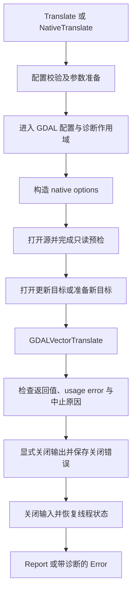

# GDAL 能力封装设计

状态：已实现，完成两位 Astra 6 max 代码审查及修复复核。日期：2026-11-13。设计基线：`8877910`；实现合并当前共享修复后的基线：`1b6b8fd`。验证范围及结果见 [GDAL 验证记录](GDAL_VALIDATION.md)。

本次允许完全重写现有 GDAL 转换 API，不要求保留 `to_geoparquet`、`to_pg_dump` 或原有转换函数的兼容入口。先交付矢量格式转换；后续按相同的调用习惯接入 raster translate、warp 等能力。本文接口已实现；完整验证及双模型代码审查结果见末尾交付记录。

## 1. 设计结论

采用“具体操作的 builder + 少量共享执行设施 + 私有 GDAL FFI”的结构。

- 普通调用使用 `vector::Translate`，常用行为通过明确的方法和枚举设置。
- 驱动名称、打开参数、创建参数保持开放，允许使用本机 GDAL 提供的新驱动和选项。
- 高级调用使用 `vector::NativeTranslate`，传入 GDAL utility 参数数组。它与类型化参数入口分开，共用一个内部执行器。
- 输入使用拥有配置的 `dataset::Source` 描述符；执行时才打开 dataset。
- 同步 `run()` 完成转换和输出关闭后返回。应用自行决定是否放入 blocking 线程。
- 共享现有 `Cancellation` 和 `GdalOptions`，抽出进度、诊断与资源收尾机制。
- 继续调用 `GDALVectorTranslate`，不启动 `ogr2ogr` 子进程，也不重写逐要素搬运循环。

本轮不引入通用 `Operation` trait、算子注册表、任务状态机、DAG、线程池或新的 crate。未来功能通过新的具体操作类型加入，不依靠一个持续膨胀的全能配置结构。

## 2. 现有实现与调整范围

| 当前位置 | 当前情况 | 处理方式 |
| --- | --- | --- |
| `src/vector/convert.rs` | 两个格式专用函数，固定投影、字段名和部分几何策略 | 用统一转换入口替代，旧行为改为显式调用示例 |
| `src/gdal_ext/vector/vector_translate.rs` | 已封装 utility C API 和 options 生命周期 | 保留执行路线，补 usage error、进度、诊断和明确的句柄所有权 |
| `src/config/gdal.rs` | 显式配置、线程局部作用域和配置恢复 | 直接复用；配置范围覆盖打开、转换和关闭 |
| `src/control.rs` | 已有可共享的取消 token | 直接复用，不另造取消 token |
| `src/gdal_ext/raster/progress.rs` | 已有 C 回调、进度规范化和 panic 捕获 | 移到共享位置，增加取消原因与 panic 原因记录 |
| `src/raster/convert.rs` | 公共进度类型位于 raster，已有多个 GDAL 操作 | 迁移共享类型及必要调用，raster 新 builder 后续再做 |
| `src/gdal_ext/destination.rs` | 现有 raster/vector 句柄交接辅助 | 复核所有权；不直接作为新公共输出类型 |
| `src/gdal_ext/ffi.rs` | CPL 错误、路径到 C 字符串等辅助 | 复用可用部分，修正路径的有损字符串转换 |

内部迁移还必须覆盖 `src/postgis/test_support.rs`、`src/postgis/vector/source.rs` 中调用矢量转换生成 fixture 的测试，以及 raster 的 translate、warp、DEM 回调和 `examples/raster_convert.rs`。公共导出、README、测试说明、第三方归属说明也在交付范围内。

PostGIS writer 的事务、类型映射和报告语义继续独立。格式转换成功不等于 PostGIS 导入事务成功。相邻仓库的消费者不在本次修改范围内，破坏性 API 迁移需要单独通知和适配。

## 3. 调用方式

### 3.1 最简单的转换

```rust,ignore
use spatial_core::vector::Translate;

let report = Translate::new("roads.shp", "roads.gpkg")
    .run()?;
```

默认按输出名称与已安装驱动推断格式；复用 `gdal::DriverManager` 的能力，不维护扩展名到驱动的自定义列表。没有匹配或存在歧义时，要求显式指定 `.driver("GPKG")`。已有数据集拒绝覆盖。

默认不重投影、不改变维度、不修复几何、不跳过失败要素；不额外强制保留或重建 FID。目标格式自身的能力限制仍然存在，不能将这些默认值表述为任意格式之间的无损转换保证。

有 schema、零要素的图层可以正常转换为空图层；没有可选图层的数据源报错。无几何属性表按目标 driver 的支持情况处理，不人为要求每条记录都有 geometry。

原来的格式专用功能分别写为 `Translate::new(input, output).driver("Parquet")` 和 `.driver("PGDUMP")`。原来固定的 `FID`、`SCHEMA`、`GEOMETRY_NAME` 等用 `.layer_option(key, value)` 设置；4326、二维化、make-valid 和 skip-failures 由调用方逐项选择，不再随格式隐式启用。

### 3.2 用户设置输入、转换和输出参数

```rust,ignore
use spatial_core::dataset::Source;
use spatial_core::vector::{Dimensions, Translate};

let source = Source::new("roads.shp")
    .allowed_drivers(["ESRI Shapefile"])
    .open_option("ENCODING", "UTF-8");

let report = Translate::new(source, "roads.gpkg")
    .driver("GPKG")
    .layers(["roads"])
    .where_clause("class = 'primary'")
    .fields(["name", "class", "width"])
    .reproject_to("EPSG:3857")
    .dimensions(Dimensions::Xy)
    .layer_name("main_roads")
    .layer_option("SPATIAL_INDEX", "YES")
    .run()?;
```

只有调用 `dimensions` 才降维；只有调用 `reproject_to` 才改变坐标。驱动选项使用分开的 key/value，不要求调用者拼接 `KEY=VALUE`。

### 3.3 多图层与显式写入模式

```rust,ignore
use spatial_core::vector::{Translate, WriteMode};

// 创建新的多图层数据集。
Translate::new("source.gpkg", "export.gpkg")
    .driver("GPKG")
    .layers(["roads", "buildings"])
    .run()?;

// 仅替换已经存在的 roads 图层。
Translate::new("revised_roads.geojson", "existing.gpkg")
    .layer_name("roads")
    .write_mode(WriteMode::ReplaceLayer)
    .run()?;
```

第一版对已有数据集的更新一次只处理一个源图层或一个 SQL 结果，并要求显式目标图层名。这样可以在写入前检查完整目标，避免处理到第二个图层时才发现名称冲突。

### 3.4 原生参数入口

```rust,ignore
use spatial_core::dataset::Source;
use spatial_core::vector::NativeTranslate;

let source = Source::new("roads.gpkg");
let report = NativeTranslate::new(
    source,
    "simplified.gpkg",
    ["-f", "GPKG", "-simplify", "2", "-nlt", "PROMOTE_TO_MULTI", "roads"],
)
.run()?;
```

这是 `GDALVectorTranslateOptionsNew` 的参数数组，不是 shell 命令：不包含 `ogr2ogr`、源文件名、目标文件名，不添加 shell 引号。每个数组元素是一个完整 token；SQL 整句通常是一个 token，源图层名可作为尾部位置参数。

`NativeTranslate` 只提供源描述、GDAL 配置、执行与控制方法，不提供 `.driver()`、`.reproject_to()` 等类型化设置。两类 builder 都生成私有执行请求；不复制打开数据、执行 FFI、捕获诊断和关闭资源的代码，也不公开泛型状态机。

原生入口遵循 GDAL 参数的写入语义，包括 `-append`/`-overwrite` 的行为，不附加类型化入口的 `CreateDataset` 语义。原生入口可能修改已有输出；调用者选择它时必须明确这一点。参数原样保留次序和重复项，不宣称“最后一个参数总是生效”。

### 3.5 进度、取消及异步应用

```rust,ignore
use std::ops::ControlFlow;
use spatial_core::control::Cancellation;
use spatial_core::operation::Control;
use spatial_core::vector::Translate;

let cancellation = Cancellation::default();
let mut on_progress = |progress: &spatial_core::operation::Progress| {
    println!("{}: {:.1}%", progress.message, progress.fraction * 100.0);
    ControlFlow::Continue(())
};
let mut control = Control::default()
    .cancellation(&cancellation)
    .on_progress(&mut on_progress);

let report = Translate::new("roads.gpkg", "roads.fgb")
    .run_with(&mut control)?;
```

回调返回 `ControlFlow::Break(())` 也表示请求取消。回调可以借用调用者状态，要求 `Send`，不要求 `'static`；`Control` 不存入可复用的转换配置。回调可能由 GDAL 工作线程调用，私有桥接保证用户闭包不会并发执行，调用者不能依赖固定的回调线程。

```rust,ignore
let job = spatial_core::vector::Translate::new("roads.gpkg", "roads.fgb");
let report = tokio::task::spawn_blocking(move || job.run()).await??;
```

需要异步取消时，将 token 克隆到 blocking 闭包，在闭包内构造 `Control`。取消后继续等待任务退出；中止或丢弃 `JoinHandle` 不能终止已开始的原生 GDAL 调用。

## 4. 参数设计

### 4.1 按作用阶段区分

| 参数类别 | 目标接口 | 生效位置 |
| --- | --- | --- |
| 输入位置 | `Source::new(path)` / `Source::gdal_name(name)` | 本地文件，或明确的 VSI/连接名称 |
| 输入驱动限制 | `Source::allowed_drivers(...)` | `GDALOpenEx`（保留本地路径字节） |
| 输入打开参数 | `Source::open_option(key, value)` | `GDALOpenEx`（保留本地路径字节），对应 CLI 的 `-oo` |
| 输出格式 | `Translate::driver(name)` | 输出驱动选择，通常对应 `-f` |
| 数据集创建参数 | `dataset_option(key, value)` | `-dsco`，只用于创建数据集 |
| 图层创建参数 | `layer_option(key, value)` | `-lco`，只用于创建或替换图层 |
| 输出打开参数 | `output_open_option(key, value)` | 类型化更新模式打开已有目标时使用 |
| 转换语义 | 投影、图层、过滤、字段、维度等方法 | 编译为 utility 参数 |
| GDAL 运行配置 | `gdal_options(GdalOptions)` | 当前执行线程的 GDAL 配置作用域 |
| 控制与观察 | `run_with(&mut Control)` | 本次执行的取消和进度 |

不能用一个 `HashMap<String, String>` 混放这些参数；`ENCODING` 等相同名称在不同阶段可能有不同意义。

`Source` 自己拥有位置和选项，没有打开的 dataset；支持路径的便利转换。VSI、URL、数据库连接名称必须用 `Source::gdal_name` 明确传入，原样交给 GDAL，不使用文件系统 canonicalize。目标的类型化入口第一版限于本地文件或目录数据集；VSI、数据库连接等原生输出名称通过 `NativeTranslate` 使用。

`Source` 是转换入口的 GDAL 打开描述符，不代替 PostGIS `VectorSource` / `RasterSource` 的 schema、流式读取与生命周期职责。是否进一步复用其内部打开逻辑，应在实现时按真实调用点决定，不为了命名一致重写已经完成的导入管线。

本地路径用 `PathBuf`/`OsStr` 保存。Unix 路径可用原始字节构造 C 字符串；平台或依赖不支持的编码明确报错，禁止 `to_string_lossy()` 后访问另一个路径。类型化输出不接受远程 URI 冒充本地路径。

### 4.2 第一版类型化参数

| 方法或类型 | 默认值与约束 |
| --- | --- |
| `driver(name)` | 推断；显式值使用 GDAL 驱动短名，不枚举所有格式 |
| `layers(names)` | 所有源图层；显式空集合报错；顺序保留 |
| `sql(query, SqlDialect)` | 未设置；与显式图层列表、`where_clause` 或首版类型化追加模式冲突时在写前报错 |
| `where_clause(expression)` | 无过滤；字符串表达式交由 GDAL 解释 |
| `fields(names)` | 全部字段；字段名由库编码为 `-select`，调用方不手工转义 |
| `spatial_filter([xmin, ymin, xmax, ymax])` | 无；有限数值且最小值不大于最大值；使用源坐标系，仅筛选而不裁剪几何 |
| `layer_name(name)` | 新建时采用源图层名；多图层导出不能合并到一个名字 |
| `source_srs(definition)` | 不覆盖源 CRS；第一版只在显式重投影时允许设置 |
| `reproject_to(definition)` | 不重投影；改变坐标，对应 `-t_srs` |
| `assign_srs(definition)` | 不修改 CRS 标记；仅赋值，对应 `-a_srs`；不能与重投影并用 |
| `dimensions(Dimensions)` | 不额外限定；显式选择 `Xy / Xyz / Xym / Xyzm` |
| `make_valid(bool)` | `false`；这是显式几何修改策略 |
| `error_policy(ErrorPolicy)` | `Abort`；可明确选择 `SkipFailures` |
| `write_mode(WriteMode)` | `CreateDataset`，详见下一节 |

`SqlDialect` 提供 `Native / Ogr / Sqlite`。新的或不常见 dialect、FID 处理、复杂裁剪、字段类型映射、坐标精度、事务批次等先通过原生入口使用；有实际高频需求再增加类型化方法。

类型化图层名和输出图层名不能以 `-` 开头，否则 utility parser 可能把名称识别为选项而扩大选中范围；首版明确拒绝，并建议用正确引用标识符的 SQL 选择这类源图层。GDAL 3.12.2 不支持通用 `--` 分隔符，不能依靠 shell 引号或该分隔符修复名称歧义。字段列表使用独立的字段引用编码，版本不支持时在写前拒绝。

builder 使用消费式 setter 和私有字段，添加 `#[must_use]`。字符串接受 `impl Into<String>`；字符串集合接受 `IntoIterator`；路径接受 `AsRef<Path>`。不要求调用者构造 `Vec<String>`，不引入 builder 宏依赖。

构造和 setter 只保存纯配置，不打开文件。`run` 统一校验并返回类型化错误，避免每个 setter 都需要 `?`。同一个单值 setter 再次调用会替换旧值；集合 setter 替换整个集合；不同语义的冲突不能静默覆盖。key/value 选项同类同名最后一次设置替换前值，键按 GDAL 常用的 ASCII 大小写不敏感方式匹配。

公共枚举按演进需要使用 `#[non_exhaustive]`，数据配置可 `Clone`；运行中的句柄、回调和 guard 不可复制。Debug 不输出连接字符串、GDAL 配置值、原生参数全文或可能包含敏感信息的 SQL。

### 4.3 写入模式的精确定义

| 模式 | 前提 | 行为 |
| --- | --- | --- |
| `CreateDataset` | 输出数据集不存在 | 创建数据集；可转换多个图层 |
| `CreateLayer` | 输出数据集存在，指定目标图层不存在 | 只创建这个图层 |
| `ReplaceLayer` | 输出数据集和指定目标图层都存在 | 删除并重建这个图层；其他图层保留 |
| `AppendFeatures` | 输出数据集和指定目标图层都存在 | 向这个图层追加要素；不自动增加字段 |

GDAL 的 `-overwrite` 指向图层；不能包装为含义模糊的 `.overwrite(true)`。原生 `-append`/`-overwrite` 还可能在目标不存在时创建数据集；类型化更新模式应先以 update 打开目标，再传 `hDstDS`，不继承这种回退行为。[GDAL 3.12.2 实现](https://github.com/OSGeo/gdal/blob/v3.12.2/apps/ogr2ogr_lib.cpp#L2636-L2755)

更新模式不允许 `-dsco`；追加模式不允许 `-lco`、字段投影、重建字段等创建语义。如果用户还指定输出 driver，它必须与已存在数据集的 driver 相符。打开参数只在打开已有输出时使用。

追加按字段名映射；预检缺失/额外字段和明显不兼容类型，避免整列被忽略后仍按普通完成返回。第一版类型化追加不接受 SQL 结果源，因为它的结构不能在不执行 SQL 的情况下可靠取得；这个组合通过原生入口使用。具体值的溢出、驱动转换及约束错误仍交给 GDAL，不复制 PostGIS 的精确类型系统。

追加还必须比较本次有效输出 CRS 与目标几何字段 CRS。有效输出取显式重投影/赋值后的 CRS，未设置则取源 CRS；按 CRS 语义及实际坐标轴映射比较，不能只比较 EPSG 字符串。无法确认等价时在写前拒绝，要求显式选择与目标一致的 `reproject_to` 或 `assign_srs`。无几何属性表不需要 CRS。首版追加要求几何字段数量和类型/维度相容；多几何列必须名称唯一、名称及顺序一致，再逐列校验 CRS。GDAL 存在按名称映射和按位置直接写入的不同路径，因此首版不接受几何列重排；单几何列允许驱动常见的列名变化。不会用目标 CRS 标签掩盖源坐标未变换的问题。

开放 driver options 不等于允许绕过写入模式。类型化入口保留会改变写入模式、目标身份或执行任意 SQL 的已知选项：禁止用户传入 `OVERWRITE` 和输出 `PRELUDE_STATEMENTS`；启用 `LAUNDER` 等名称改写的组合在无法可靠预检时拒绝，转用 Native 入口。首版使用有限的受测规则，不构造完整参数白名单或 driver 参数框架。目标以 update 打开也可能有副作用，错误输出状态从该边界起保守标记。

`CreateDataset` 不自动删除、清空或替换已有目录。针对 Shapefile 等多文件输出，预检已存在的伴随文件和目录目标；不能只检查 `.shp` 主文件后覆盖同名 `.dbf`。无法可靠判定目标是否安全时拒绝类型化创建，建议使用一个新的空输出目录。

首版对上述预检建立受测的输出策略：GPKG、GeoJSON、FlatGeobuf 文件型输出及 Shapefile 文件组/目录；GPKG 还要检查已知的 journal/WAL/SHM 等伴随名称，不能简单视为仅有一个物理文件。其他 driver 只有在调用方独占的新空目录中创建，或通过原生入口使用；不凭通用 driver metadata 猜测未知格式会创建哪些文件。可选 Parquet 和 PGDump 在对应驱动测试通过后纳入受测策略。

同源同目标及本地可识别的符号链接/硬链接别名在写前拒绝。输入使用 `GDALGetFileList`，目标结合已知 Shapefile/GPKG 伴随文件及目录成员交叉检查；这同时覆盖输入 `.dbf` 被新输出 `.shp` 的伴随文件覆盖、源与目标仅共享 `.dbf` 硬链接等情况。独立的同名 `roads.geojson` → `roads.shp` 可以正常转换。未知 driver 隐藏文件、VSI/远程别名不承诺完全识别。文件存在性检查不等于跨进程锁：调用方必须独占目标文件或数据集；第一版不提供跨进程原子 create-new 保证。

Shapefile 的类型化 `CreateLayer` 必须以目录数据集为目标，避免单文件视图漏掉旁侧已有图层。类型化更新的图层名限 Unicode 字母数字、`_` 和 `-`，拒绝 GDAL 会清洗或解释为文件路径的名称；其他名称通过 Native 入口明确采用原生语义。

转换失败、取消或关闭失败可能留下部分输出；追加与替换也可能已经修改了已有数据。第一版不承诺统一事务回滚、自动删除产物或原子 rename 发布。尤其不能在出错后猜测文件列表并删除用户原有数据。

### 4.4 原生参数的边界

1. 参数序列交给 GDAL 解析；不维护全部合法 flags 的白名单，不自行模拟完整 CLI。
2. `-oo`、`-if` 必须通过 `Source` 配置；`--config`/线程配置必须通过 `GdalOptions` 配置。实现对这些保留 token 做 ASCII 大小写不敏感的保守拒绝，给出正确入口（包括 `-OO`、`-IF`）；识别配置 token 的等号形式。该检查不推断任意 GDAL 参数的参数个数；极少数将保留 token 本身作为字面值的调用也会被拒绝。
3. 这是必要的边界检查：源数据在调用 utility 前已经打开，`-oo`/`-if` 即使被 options parser 接受也不能重新配置该句柄。`-doo` 则属于 utility 的目标打开阶段，可在原生模式使用。
4. 驱动创建选项、转换参数和尾部图层名保持原样；未知选项或不支持的版本由 GDAL 返回解析错误。
5. 不拼接 shell，也不把完整参数记录到日志。原生入口仍须捕获诊断、支持控制、明确关闭输出，不能成为绕过资源管理的第二条执行路线。

类型化模式与原生模式不互相合并，避免强行定义 `-append`、重复 `-lco`、多个 CRS 参数的统一“覆盖优先级”。

## 5. 执行流程与资源所有权



### 5.1 写入前尽量发现确定错误

在创建输出前检查：NUL、空键、键中的 `=`、空图层名、非法范围、互斥参数、驱动缺失、版本门槛、可解析的 CRS、已知的输入/输出身份冲突，以及输出存在性。

纯 Rust 参数准备不产生 I/O。key/value 选项的键拒绝 `=`、`:`、空白与 NUL；GDAL 同时把冒号视作分隔符，不能只检查等号。`GDALVectorTranslateOptionsNew` 是原生操作，必须在配置和诊断 guard 内执行；它可能读取 `-sql @file`、`-where @file` 等文件并报告 CPL 错误。类型化 SQL/where 接收表达式而非隐式 `@file`；文件参数留在 Native 入口，避免预检与实际执行解释不同。

打开输入后检查可直接获取的图层、字段、单/多图层约束和输出驱动能力；对显式 `where_clause` 在选中图层上调用 GDAL 的过滤设置检查，不能因为启用 SkipFailures 就忽略非法过滤条件后导出全部数据。SQL 模式只提前检查参数组合，不为预检执行一遍 SQL、再让 utility 重复执行；这会增加代价，也可能得到不同结果。实际 SQL 求值、结果层结构及数据读取错误仍可能发生在输出创建之后，按部分输出契约报告。也不为报告额外做全量 feature count。

驱动 metadata 只能辅助检查，不能证明所有输入都可转换；实际写入仍可能失败。未知 driver option 也不能一概判错，因为不同驱动和版本的选项不同；保留 GDAL 的诊断，不将“参数成功保存”为字符串等同于“驱动已采用参数”。

### 5.2 句柄的明确归属

- `Source` 在执行线程中以 vector/read-only 打开源 dataset，FFI 只借用它；源不会转移所有权给 GDAL。打开 flags 由具体操作决定，不把写权限或 vector/raster 模式塞进可随意组合的用户选项。
- 新建输出：utility 返回的新句柄只包装一次，随后显式 `Dataset::close()`。
- 更新输出：Rust 保持已打开目标的唯一所有者。utility 返回相同 `hDstDS` 时不再构造第二个 owner；成功或失败都由原 owner 关闭。
- 返回空指针时，只关闭当前仍由 Rust 持有的句柄，不能对 GDAL 已经清理的创建失败句柄再次关闭。
- `GDALVectorTranslateOptions`、C 字符串数组和回调状态必须活到同步 C 调用结束，使用 RAII 清理。
- `pbUsageError` 使用实际输出变量，区分无效调用参数与数据处理失败。

原生新建路径在失败时，GDAL 可能在内部关闭输出且只返回空指针；此时只能保留当次捕获的诊断，不能声称拿到了一个可再次关闭或完整审计其 close 状态的句柄。

源图层的游标、过滤器可能被 utility 改变。第一版不接受外部借来的 `&Dataset`；若以后增加句柄输入，应评估独占借用 `&mut Dataset` 或显式转移所有权，不能仅为减少打开成本绕过这项状态约束。

### 5.3 成功与错误

成功必须满足：utility 成功、没有已记录的取消或回调 panic、所持有的输出句柄显式关闭成功。之后完成输入关闭与 guard 恢复再返回。源关闭失败仍返回带关闭阶段的错误，且说明输出可能已经完成；不能要求调用者直接重试追加操作。

`Dataset::Drop` 用于兜底释放，不能用来确认落盘成功。`gdal 0.19` 的 `Dataset::close()` 是否检查返回值取决于编译期配置；本 API 的完整关闭契约要求构建使用的 GDAL 开发库和运行库都至少为 3.7，并保持版本兼容。旧版本在写入前拒绝，不能仅检查运行库而忽略 headers。这不等于声明所有后续 GDAL 版本均兼容。

`operation::Error` 使用 `thiserror`，可区分以下原因，并通过访问方法保留诊断、发生阶段、目标可能已修改的状态以及独立的收尾错误：

| 原因 | 调用方可据此判断 |
| --- | --- |
| `InvalidArgument` / `Unsupported` | 修正参数、安装驱动或更换受支持版本 |
| `OutputExists` / `LayerExists` / `LayerNotFound` | 修正输出或选择正确的显式写入模式 |
| `Open` / `Translate` / `Close` | 检查原生错误及对应阶段 |
| `Cancelled` | 请求已被执行路径观察到，输出可能部分完成 |
| `CallbackPanicked` | 修正回调；不能误归类为用户取消 |

主失败先保存，再尝试关闭；不能让 close 覆盖原始错误，也不能把收尾错误扔掉。错误中的“尚未写入”仅在确实未进入任何可能写入的 GDAL 调用时报告；其余情况保守标为“可能已修改”，不是伪造精确提交状态。

输出和输入的收尾错误按来源分别保留，允许同时存在；不得设计成一个会被后续错误覆盖的 `cleanup_error`。公开错误与报告保持 `Send + Sync`，回调借用不进入结果对象。

### 5.4 诊断与返回报告

`run()` 返回 `Result<operation::Report, operation::Error>`。报告包含有界的 GDAL 诊断和截断标记；诊断保留等级、错误号和消息。初始固定保留最多 64 条、每条最多 4 KiB，标记条目和消息截断；不为这两个上限增加第一版公共配置。是否观察到 failure 独立记录，不能因前 64 条已经填满而丢失失败状态。

成功报告表示本次所选转换策略执行完成且输出关闭成功，不代表要素逐个无损。默认不提供 `written_count`、`skipped_count` 或 `output_files`：utility API 没有统一可靠的逐要素统计和完整产物清单，不能用 0 代替未知，也不能为填报告强制全量读回。

`Abort` 不加 `-skipfailures`，执行阶段观察到的 `CE_Failure` 也作为失败保留。`SkipFailures` 允许 GDAL 继续处理它支持跳过的错误：非空返回句柄加可接受的执行状态可以形成带诊断的报告，但关闭失败始终是错误。原生模式按 native 返回结果判断，同时保留运行诊断，不能套用类型化 `Abort` 的额外规则。

因此不能直接用现有 `checked_gdal_call` 的“出现 failure 一律返回错误”包装所有原生调用，更不能只读最后一条 CPL 错误推断跳过数量。库已识别的结构/参数错误与最终关闭失败不因 `SkipFailures` 而放行；GDAL 内部还能跳过哪些失败以其实现为准，不能声称这个模式只会跳过单个坏 feature。

诊断 handler 使用线程局部的 push/pop 作用域，覆盖配置应用/恢复、打开、执行和关闭。先进入诊断 guard，再进入配置 guard；关闭输入输出后显式恢复配置，再提取报告和恢复先前 CPL 状态。回调内部只做有界保存，不调用用户逻辑或再次调用 GDAL，防止递归和无界内存增长。GDAL 内部可能临时替换 error handler，不承诺捕获其隐藏的全部信息。

用户进度回调是单独的诊断边界：在实际执行用户代码的线程上临时隔离 handler，并保存、恢复 CPL 错误状态。用户已经处理的内部 GDAL 错误不能进入外层诊断或设置外层 failure 标记。仅在回调结束时 `CPLErrorReset()` 不够；Warp 的工作线程可能收集并重放错误。独立 Control 的嵌套操作可以建立自己的诊断作用域，同一个正在执行的回调状态不得重入。

## 6. 进度、取消与线程约束

`operation::Control<'a>` 借用可选 `Cancellation` 和 `FnMut(&Progress) -> ControlFlow<()> + Send`。`Progress` 复用现有 fraction/message 模型；不以百分比推算处理条数，也不承诺驱动会发出固定频率、严格单调的回调。

私有 callback state 使用同步保护：从 C 指针取得共享引用后再通过锁访问闭包，不能先制造跨线程独占引用再加锁。回调锁与诊断锁分离，调用 utility 时不持有回调锁；捕获 panic 和记录第一次中止在受保护状态中完成，不能让 poisoning 引发二次 panic。只接入返回前保证所有回调已经结束的同步 C API，确保借用及 state 地址一直有效。

必须覆盖以下事实：

1. `GDALVectorTranslateOptionsSetProgress` 设置函数指针，并不会为所有路径自动打开进度；执行器在需要进度或取消时启用 `-progress` 并安装回调。
2. GDAL 3.12.2 对某些没有 fast feature count 的矢量图层或 SQL 结果会关闭进度。不能为了取消而偷偷全量数一遍，也不能承诺这些路径中途一定响应取消。[对应源码](https://github.com/OSGeo/gdal/blob/v3.12.2/apps/ogr2ogr_lib.cpp#L3641-L3707)
3. 在打开源前和开始写入前检查 token；进入原生调用后只能在 GDAL 提供的回调点协作中止。网络阻塞和驱动内部 I/O 不受 token 的硬中断控制。
4. 回调捕获 panic，记录 `CallbackPanicked` 并返回停止值；只在 C 调用返回后形成 Rust 错误。该保护适用于 unwind 构建，不能恢复 `panic=abort` 导致的进程终止。
5. 记录第一次被执行路径观察到的中止原因，停止后不再调用用户回调。即使 GDAL 最终返回非空句柄，也要关闭它并报告已记录的中止。
6. `fraction == 1.0` 不表示输出已关闭，应用只能以 `run` 成功返回作为完成依据。
7. 如果取消请求到达过晚或原生路径未观察到，已经成功完成并关闭的转换返回成功；不能在结束后仅因 token 已置位而伪装成回滚或已取消。

库在发起线程完成打开、utility 调用、关闭和配置 guard 恢复；utility 内部可以使用其他线程，`warp -multi` 已证实会从原生工作线程调用进度回调。不同任务各自打开 dataset；不在多个线程同时使用同一个 dataset 的不同 layer。GDAL 3.10 的线程安全 dataset 能力只覆盖特定只读 raster 场景，不能用于证明 vector 句柄可共享。[GDAL 线程说明](https://gdal.org/en/stable/user/multithreading.html)

这是一项执行约束，不是声称 `gdal::Dataset` 没有 `Send` 实现。第一版配置对象可在线程间移动，已打开的句柄不会作为转换结果返回。

线程局部 guard 只保证配置值的作用域和恢复，不把 GDAL 的全局状态变成每任务独立状态。例如 `GDAL_CACHEMAX` 控制全局 block cache，且只在首次读取时采用配置；驱动注册也有初始化阶段。进程级初始化仍由应用负责，不能宣传任意 GDAL 配置都能在并发任务中分别生效。[GDAL 配置说明](https://gdal.org/en/stable/user/configoptions.html)

## 7. 文件组织

第一阶段只建立确实被使用的文件；小类型按职责放在同一文件，不按每个 enum 拆文件。

```text
src/
├── lib.rs                       # 公开 dataset、operation；保留 vector/raster/postgis 等模块
├── dataset.rs                   # Source 描述符、输入打开选项和位置表示
├── operation.rs                 # Control、Progress、Report、Diagnostic、Error 等公共值类型
├── control.rs                   # 复用 Cancellation 等已有类型
├── config/
│   └── gdal.rs                  # 复用 GdalOptions 和线程配置 guard
├── vector/
│   ├── mod.rs                   # re-export Translate、NativeTranslate 和相关枚举
│   ├── translate.rs             # 类型化 builder、共用执行编排及公开接口回归
│   ├── target.rs                # 输出身份、伴随文件、schema/CRS 等写入预检
│   ├── options.rs               # 私有参数结构、公共语义枚举、类型化参数编译
│   └── native.rs                # 原生参数 builder；委托同一执行器
├── gdal_ext/
│   ├── mod.rs
│   ├── ffi.rs                   # CPL 错误与路径转换等小型 FFI 工具
│   ├── destination.rs           # 现有 raster 路径需要的私有 helper
│   ├── progress.rs              # 从 raster/progress.rs 移出，C trampoline 与中止状态
│   ├── diagnostics.rs           # 线程局部 error handler guard、有界诊断收集
│   ├── vector/
│   │   ├── mod.rs
│   │   └── translate.rs         # 原 options RAII + utility FFI；与公共层名称一致
│   └── raster/                 # 现有实现调整共享引用；不预建未来的空文件
├── raster/                     # 后续接入 Translate、Warp 等具体 builder
└── postgis/                    # 仅适配受影响的共享调用与测试 fixture

examples/
├── vector_convert.rs            # 自生成输入，转换并读回校验
└── raster_convert.rs            # 同步调整进度类型的引用

docs/
├── GDAL_API_DESIGN.md
├── GDAL_VALIDATION.md           # 本次真实数据、回归和双模型审查记录
└── TESTING.md                   # 实现时增加矢量转换覆盖范围与可选 driver 检查方式
```

删除旧 `src/vector/convert.rs` 及其导出；重命名旧 `vector_translate.rs` 时保留第三方版权声明和相应 notice。`operation.rs` 如果以后出现实际独立职责再拆目录，不提前铺设框架。

私有测试放在对应源码文件的 `#[cfg(test)]` 模块；native/C 边界测试放 `gdal_ext` 对应文件；完整公开接口测试放 `vector/translate.rs`。若未来需要独立集成测试，按仓库规定镜像源码路径，同一源码最多一份，不再复制一套平行 fixture 目录。

## 8. 后续能力如何接入

| 后续能力 | 建议入口 | 可以复用的部分 | 必须独立的部分 |
| --- | --- | --- | --- |
| raster 格式转换 | `raster::Translate` | Source、控制、诊断、配置、关闭约定 | 波段、窗口、数据类型、创建选项 |
| raster 重投影/拼接 | `raster::Warp` | 同上及 C 回调桥接 | 多源、分辨率、范围、重采样、NoData、warp options |
| DEM 处理 | `raster::Dem` | 同上 | hillshade/slope 等模式和专属参数 |
| 矢量裁剪/重投影 | 先使用 `vector::Translate` 的明确参数或原生入口 | 已有执行路径 | 只有实际调用需求足够独立时才新增专门 builder |
| polygonize/rasterize 等 | 各自明确命名的操作入口 | 控制、配置、诊断、资源归属 | dataset/layer/band 角色和各自 C API |

vector 与 raster 的 options 互不混用，不要求所有操作都实现同一个 trait 或返回一个拥有句柄的万能结果。仅统一 `run` / `run_with`、配置和失败处理的调用习惯。`Warp` 的多输入能力到实际接入时再设计，不给第一版 vector API 塞入当前只能接受一个源的 `Vec<Source>`。

如果将来需要返回内存 dataset，单独设计拥有句柄的结果和显式 finish/close 责任；不改变本次“返回成功时输出已关闭”的契约。

## 9. 交付顺序与验收

### 阶段一：固定最小可用的公共接口

完成 `Source`、`Translate`、`NativeTranslate` 的接口和明确的参数边界；支持 GPKG、GeoJSON、FlatGeobuf、Shapefile 的基本转换。实现共用执行器、类型化错误、诊断和显式关闭。提供自生成输入的公开例子。

### 阶段二：完成首版全部语义

补齐四种写入模式、图层/SQL/字段过滤、CRS、维度、驱动选项、进度取消；迁移共用回调及所有内部调用。GeoParquet、PGDump 改成显式参数示例，不恢复两个固定业务策略入口。

阶段一和阶段二合起来才是本文规定的首版；不能以“基本格式能转换”代替完成资源、取消和失败行为。

### 必须执行的验证

| 范围 | 必须证明的行为 |
| --- | --- |
| 真实 GDAL 往返 | GPKG ↔ GeoJSON、GPKG ↔ FlatGeobuf、Shapefile ↔ GPKG；重新打开结果验证字段、几何、CRS 和已知记录 |
| 驱动限制 | 长字段名、NULL、整数边界、时间文本、Z/M/ZM、空几何、混合几何；按目标 driver 能力断言，不使用统一“完全相同”假设 |
| 多图层 | 完整复制所选图层；单图层目标和重名冲突在写入前拒绝 |
| 写入边界 | 已有输出不被默认覆盖；CreateLayer 重名、ReplaceLayer 缺失、AppendFeatures 缺失均失败；追加的额外字段/不兼容 schema 在写前拒绝；其他图层及已有数据保留符合各模式语义 |
| 多文件与身份 | Shapefile 伴随文件冲突、目录存在、同源同目标、符号链接/硬链接别名；失败不得清空已有目录 |
| 参数传递 | 输入 `-oo`、输出打开、`-dsco`、`-lco` 分别对真实数据生效；未知选项的诊断可见；参数中的空格不经过 shell 分词 |
| SQL 与字段 | 中文、空格、逗号、双引号字段；参数组合错误在写前失败；SQL 求值错误正确报告可能存在的部分输出；GDAL 3.9 前不支持的字段引用组合明确报错 |
| CRS 与几何 | assign 与 reproject 用实际坐标值区分；默认保留可支持的维度；make-valid 与 skip-failures 只有显式设置才启用；非法 where 不因 skip-failures 而取消过滤 |
| 原生入口 | 和等价类型化配置结果一致；保留原生选项次序；错误 flags、保留 tokens、NUL 在写前失败 |
| 取消与 panic | 预取消不创建输出；可回调路径中途取消；回调 panic 不跨 C ABI；关闭资源后可删除/重新打开文件；无回调路径不宣称即时取消 |
| 关闭失败 | 通过受控故障的输出流或最小私有 FFI 测试接缝验证 close 错误；主错误与 close 错误都保留；不能只测 Drop 被调用 |
| 配置与并发 | 同线程配置/handler 恢复；多个不同输出任务的线程局部配置相互隔离；正常、错误、取消与 unwind 退出都恢复值；不把全局 cache 算作隔离能力 |
| 诊断规模 | 超过条数/消息长度上限后仍有截断标记；SkipFailures 不无限积累诊断，也不伪造成功/跳过计数 |
| 审查修订 | 追加的隐式/显式 CRS 不匹配写前拒绝；LAUNDER/OVERWRITE 和前置 SQL 不绕过 WriteMode；前导 `-` 图层名不扩大选择；保留 tokens 大小写一致 |
| 回调归属 | `warp -multi` 的用户闭包串行执行；用户回调内已处理的 GDAL 失败及嵌套操作不污染外层诊断；原生线程错误重放不改变该契约 |
| 可选格式 | GeoParquet 在明确安装 Parquet driver 的环境读回；缺驱动为未执行或显式失败，不算通过；PGDump 检查产物内容，不称为数据库导入成功 |

先用少量合成 fixture 验证稳定契约，再用桌面真实数据做多格式抽样。所有输出写入新的临时目录，不覆盖用户原文件。真实数据应记录源类型、驱动、GDAL 版本、转换参数、读取结果和不支持项；大文件测试单列耗时和内存观察，不从小文件成功推断性能保证。

实现后执行 `bash scripts/ci/check.sh`。移动 PostGIS 共用 FFI 或 fixture 后，还需运行专用库的数据库回归，不能把 ignored 项算成通过。默认示例加入矢量转换；可选 driver 测试应有明确的必需驱动检查入口。

## 10. 本次设计的核对记录

已核对当前源码和调用点、GDAL 3.12.2 的 `ogr2ogr_lib.cpp`、本地 `gdal 0.19.0` 的 dataset/driver API，以及官方 utility、ogr2ogr 和线程文档。CodeGraph 与 GitNexus 当时对应 `8877910`；索引仅辅助定位，关键契约以实际源码为准。

本地 GDAL 3.12.2 的只读 parser 探针确认：库模式下 `-f`、`-oo`、`-if`、`-doo`、`-progress` 和尾部图层名可以被解析，而 `--config` 返回 unknown argument。结合源码可知 `-oo`/`-if` 的 binary-only 输出没有配置接收者；不能据“解析成功”认定它们影响已打开的源。

按 rust-skills 审视了所有权、builder、可演进错误及避免过度抽象；按 ponytail-review 审视了真实调用范围、已有能力复用和数据写入风险。以下问题已落实到方案：

- 不用原生 `-overwrite` 冒充整个数据集的覆盖开关。
- 不以 Drop、进度 100% 或最后一条 CPL 消息代表成功。
- 不承诺缺少回调的驱动路径可以即时取消。
- 不把类型化参数与原生参数悄悄拼接，也不复制 GDAL CLI 解析器。
- 不重复执行 SQL 做预检，也不将线程配置 guard 宣称为整个 GDAL 的状态隔离。
- 不为未来功能预建通用执行框架、重复 source/取消/config 实现或空模块。

这些核对不等于新 API 已编译、已实现或已通过转换测试。原生版本矩阵继续遵守 [TESTING.md](TESTING.md)；本文没有验证 GDAL 3.13 的兼容性。

参考资料：

- [GDAL utility C API](https://gdal.org/en/stable/api/gdal_utils.html)：句柄、options、回调和 usage error 契约。
- [ogr2ogr 参数说明](https://gdal.org/en/stable/programs/ogr2ogr.html)：转换参数、创建/打开选项及图层更新语义。
- [固定版本实现：GDAL 3.12.2](https://github.com/OSGeo/gdal/blob/v3.12.2/apps/ogr2ogr_lib.cpp)：用于避免 stable 文档随版本变化造成设计偏差。
- [georust/gdal 0.19 Dataset](https://docs.rs/gdal/0.19.0/gdal/struct.Dataset.html)：执行时还应对照本项目锁定版本的源代码。
- [GDAL 线程说明](https://gdal.org/en/stable/user/multithreading.html)：dataset 及相关对象的并发边界。

## 11. 实现交付

`Source`、两类转换 builder、四种写入模式、参数预检、共享控制/诊断和显式关闭已实现；raster 回调与 PostGIS fixture 已迁移，旧格式专用入口已删除。`build.rs` 记录 gdal-sys 报告的构建版本，配合运行版本校验 checked-close 前提。可运行示例和完整检查入口已接入。两位 Astra 6 max 发现的问题已修复并通过独立探针复核，详见 [GDAL 验证记录](GDAL_VALIDATION.md)。
