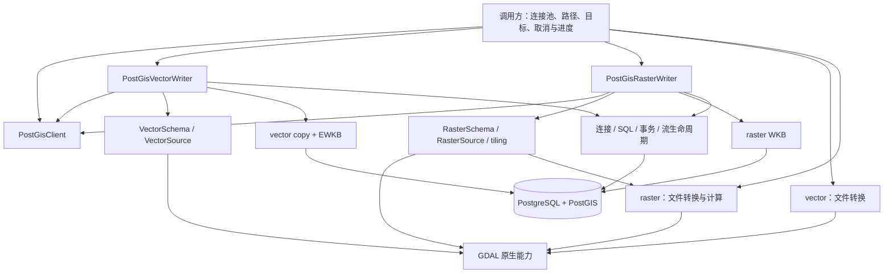

# PostGIS 导入模块完整重构方案

以 `postgis` 作为数据库能力的唯一入口，提供 `PostGisVectorWriter` 与 `PostGisRasterWriter`。两者共享连接、事务、取消和进度机制，各自拥有 schema、数据读取及 COPY 编码实现。顶层 `vector`、`raster` 保留文件转换和 GIS 计算能力。

本文是经两轮独立复审修订后的实施设计。用户已授权移除旧 API、重新划分模块、调整默认行为及不沿用旧目录规范；不建立永久兼容 facade。实现与验收状态记录在文末，不能将设计能力直接视为已验证能力。

**1. 依据与重构范围**

源码核对日期为 2026-11-12。本地基线为 `dab0024d712453dd02fb1aebac80ac765aaa72ab`；参考实现固定到 [OxiGeo 提交 9e73da7](https://github.com/cool-japan/oxigeo/tree/9e73da7a5ae6b2954adf3a6a2824349f8b0d1e79/crates/oxigeo-postgis)。当前 checkout 没有 CodeGraph 或 GitNexus 索引，本方案依据实际源码、仓库内调用点和测试定义。Context7 文档检索包含历史 TODO 与示意接口，对实现状态以固定提交的源码为准。

本次重构覆盖 PostGIS 导入、数据库元数据、GDAL 输入配置及其公开导出。相关格式转换 helper 同步归位，既有 GIS 算法无需为模块整齐而重写。保持单一独立 crate，继续使用已有 `tokio-postgres`、`deadpool-postgres`、`gdal`、`wkb-raster`、`thiserror` 等依赖。

库的边界仍由 [提取与接入说明](EXTRACTION.md) 定义：调用者负责业务身份、资源登记、任务状态、Temporal 和 DAG。允许完整重构不包含许可变更、重新发布或迁移相邻 MapSeek checkout。

**2. 重构前的结构与问题**

| 基线位置（旧文件现已删除） | 已核对的实现 | 对设计的影响 |
| --- | --- | --- |
| `src/vector/copy.rs:21` | 公开导入函数有连接池、S3、路径、表名、SRID、字段规则、回调和取消参数 | 参数按目标、输入、写入配置、运行控制分组 |
| `src/vector/copy.rs:52` | 同文件还有原始 SQL、GeoParquet、PGDump、GDAL 直写和对象路径 helper | 数据库写入与文件转换分开；收敛重复导入入口 |
| `src/pg/mod.rs:120` | 无状态 `PgCopy` 集中承载跨文件方法 | 按资源与职责组织类型，减少跨文件 `impl PgCopy` |
| `src/pg/reader.rs:116` | `reader` 实际读取 GDAL 字段，并处理 CRS、几何、字段值与 EWKB | 命名为 GDAL 输入适配，数据库编码独立 |
| `src/pg/vector.rs:42` | 同一函数负责 blocking reader、字段改名、建表、COPY、索引、统计和提交 | writer 只协调步骤，各步骤有明确输入与输出 |
| `src/pg/empty_vector.rs:15` | 空输入契约使用字符串类型，并带有 `data_revision`；字段恢复使用另一套事务 | 用统一 `VectorSchema` 描述最终数据库结构；类型恢复进入同一次写入事务 |
| `src/vector/metadata.rs:19` | 元数据查询依赖 PostgreSQL，默认列固定为 `_id`、`geom` | 迁入 `postgis::vector`，使用同一个目标 schema |
| `src/vector/metadata.rs:127` | bigint/smallint 合并成 integer，numeric 合并成 float，date 合并成 datetime | 库返回精确数据库类型，展示类型由应用转换 |
| `src/pg/vector.rs:187`、`src/pg/raster.rs:69` | vector 在事务中 DROP/CREATE，raster 在事务中 TRUNCATE | 将替表与替行定义为不同写入模式 |
| `src/raster/copy.rs:71` | 已实现 InDB/OutDB、Whole/Tiled、预算、NoData 和重投影 | raster 是现有能力的结构整理及完善，不能只留下占位模块 |
| `src/pg/raster.rs:86` | `committed_rows`、`committed_batches` 在 COMMIT 前累加，batch 实际控制 flush | 提交前使用 written/flushed；成功报告只在确认提交后生成 |

这些位置也包含必须保留的正确性保障：原生 GDAL 错误不能当作 EOF；生产者必须成功退出；失败时关闭接收通道；COPY、索引和统计提交前完成；取消之后清理数据库连接。对应实现见 `src/gdal_ext/ffi.rs`、`src/pg/vector.rs:107`、`src/pg/mod.rs:165` 和 `src/pg/raster.rs:104`。

**3. 从 oxigeo-postgis 采用的设计**

参考库的入口将连接、SQL、类型、读写和编码分开，并通过 `lib.rs` 重导出常用类型。这种组织使调用者能从名称判断对象用途。来源：[模块导出](https://github.com/cool-japan/oxigeo/blob/9e73da7a5ae6b2954adf3a6a2824349f8b0d1e79/crates/oxigeo-postgis/src/lib.rs)。

| OxiGeo 设计 | spatial-core 对应设计 | 采用范围 |
| --- | --- | --- |
| `connection`、`ConnectionPool` | `connection`、`PostGisClient` | 统一连接使用和能力检查；复用调用者现有 deadpool 池 |
| `sql`、`TableName`、`ColumnName` | `sql`、`TableName`、`ColumnName` | SQL 标识符构造时校验，生成 SQL 时引用 |
| `PostGisWriter` | `PostGisVectorWriter`、`PostGisRasterWriter` | 明确数据种类，使用一致的 builder 与 `write` |
| `types`、`PostGisGeometry` | vector/raster 各自的 `schema` 和编码类型 | 将字段类型、空间类型与传输表示分开 |
| `copy_binary`、`wkb` | vector 的 `copy`、`ewkb`，raster 的 `wkb`，共享文本 COPY 传输 | COPY 协议与空间数据编码各自负责 |
| `error`、`PostGisError` | `PostGisError`、模块级 `Result<T>` | 返回可匹配错误并保留底层 source |
| `reader`、`query` | 当前只提供具体的数据库元数据查询 | 完整空间查询器在出现明确读取需求后设计 |
| `transaction` | 私有事务辅助代码和原生 PostgreSQL transaction | 统一提交、回滚及连接清理语义 |

采用结构时需要保留 spatial-core 的数据模型。参考库的 writer 创建 `id SERIAL + geometry + properties JSONB`，而本库需要 bigint identity 和原始属性列；将所有属性装入 JSONB 会改变现有查询、索引和类型契约。参考库的覆盖处理与后续 COPY 分别取连接，也没有表达本库要求的整次导入原子性。来源：[writer.rs](https://github.com/cool-japan/oxigeo/blob/9e73da7a5ae6b2954adf3a6a2824349f8b0d1e79/crates/oxigeo-postgis/src/writer.rs#L92)。

参考 writer 在任意 COPY 错误后尝试逐行 INSERT。本方案在错误时回滚并返回原因，避免将格式错误、连接错误和提交状态不明混为一种重试。参考事务模块的 `ManuallyDrop` 包装也无需迁入，现有驱动已经提供事务所有权机制。[COPY 实现](https://github.com/cool-japan/oxigeo/blob/9e73da7a5ae6b2954adf3a6a2824349f8b0d1e79/crates/oxigeo-postgis/src/writer.rs#L228)、[事务实现](https://github.com/cool-japan/oxigeo/blob/9e73da7a5ae6b2954adf3a6a2824349f8b0d1e79/crates/oxigeo-postgis/src/transaction.rs)。

本文引用参考代码用于分析，没有复制其实现，也没有新增 OxiGeo 依赖。

**4. 目标架构与依赖方向**



顶层 `vector`、`raster` 不依赖 `postgis`。`postgis` 的输入适配器可以调用通用 GDAL 转换能力，例如栅格重投影。共享数据库模块不读取 `gdal::Dataset`，也不解释波段或 feature。

`PostGisClient` 持有已有 `Pool` 的轻量句柄和匹配的查询取消配置，提供扩展能力检查。它不维护第二个连接池、不复制 DSN 配置模型、不创建 runtime。writer 负责一次导入；COPY sink 仅写数据；schema 负责描述和校验最终表结构。每个职责都对应现有代码中的实际工作。

能力检查在本次已获取的连接上完成，避免持有连接时再次从容量为 1 的池取连接。结果包括扩展所在 schema、geometry/raster 类型及所需函数能力；生成的 SQL 使用确认后的限定名称，不假定扩展安装在 `public`。因为部分 PostGIS 函数内部仍使用未限定的类型名，事务内通过 `SET LOCAL` 设置 `pg_catalog`、已确认的扩展 schema 与最后的 `pg_temp`；提交/回滚后恢复调用方设置，不修改会影响其他请求的会话默认值。

**5. 文件组织**

下面是已落地的文件组织；GDAL 通用计算沿用原模块，数据库的共享机制保持私有。

```text
src/
├── lib.rs                         # 导出 config、control、vector、raster、postgis
├── control.rs                     # 现有 Cancellation 等通用控制原语
├── config/
│   ├── mod.rs
│   └── gdal.rs                    # 显式配置、GDAL worker 线程配置作用域
├── gdal_ext/                      # 现有 GDAL FFI、translate、warp 等实现
├── vector/
│   ├── mod.rs
│   └── convert.rs                 # GeoParquet、PGDump 等文件转换
├── raster/
│   ├── mod.rs
│   ├── tiling.rs                  # TileLayout、TileWindow、纯窗口计算
│   └── convert.rs                 # 现有栅格计算和文件转换
└── postgis/
    ├── mod.rs                     # 模块声明与精选公开导出
    ├── connection.rs              # PostGisClient、能力检查、连接获取与回收
    ├── error.rs                   # PostGisError、Result
    ├── sql.rs                     # 标识符、限定表名、小型 DDL/COPY SQL 生成
    ├── options.rs                 # WriteMode、WriteLimits、共用目标策略
    ├── progress.rs                # WriteControl、WriteStage、WriteProgress
    ├── transaction.rs             # 目标表准备、提交边界、取消和失败收尾
    ├── stream.rs                  # 私有 SourceStream<T>、背压、producer 生命周期
    ├── test_support.rs            # 仅测试：专用库、随机 schema 与合成 fixture
    ├── vector/
    │   ├── mod.rs                 # vector 公共类型导出
    │   ├── writer.rs              # PostGisVectorWriter、选项与成功报告
    │   ├── schema.rs              # VectorSchema、字段映射、PostgresType、几何列
    │   ├── source.rs              # VectorSource、GDAL 单 worker 读取及字段计划
    │   ├── table.rs               # vector 建表、索引及提交前检查计划
    │   ├── copy.rs                # 精确字段转换及文本 COPY 转义
    │   ├── ewkb.rs                # EWKB 边界校验与 GDAL WKB 适配
    │   └── metadata.rs            # 精确字段类型、geometry typmod、范围与计数
    └── raster/
        ├── mod.rs                 # raster 公共类型导出
        ├── writer.rs              # PostGisRasterWriter、选项与成功报告
        ├── schema.rs              # RasterSchema、波段契约、栅格约束
        ├── source.rs              # RasterSource、GDAL 读取、VRT 生命周期
        ├── table.rs               # raster 建表、索引、约束与 catalog 检查
        ├── wkb.rs                 # 波段到 raster WKB 的适配
        └── metadata.rs            # 栅格空间范围、波段、分辨率、tile 数

docs/
├── POSTGIS_REFACTOR.md             # 本方案
├── TESTING.md                      # 保持测试环境和验证命令的唯一说明入口
└── ...

examples/
├── raster_convert.rs              # 现有独立转换示例
├── postgis_vector.rs              # 已提供；使用显式测试 DSN
└── postgis_raster.rs               # 已提供；使用显式测试 DSN
```

每个文件的私有测试放在对应 `#[cfg(test)] mod tests`。需要独立测试时只建立一份镜像文件，例如 `tests/postgis/vector/writer.rs` 对应 `src/postgis/vector/writer.rs`。Cargo 不自动将这些深层文件都作为测试入口；应在 `Cargo.toml` 中显式登记所需 `[[test]]` 路径，并继续通过现有结构检查。初次迁移优先保留内联测试，避免额外测试装配。

`postgis::vector` 与 `postgis::raster` 为公开模块，其子文件默认私有，通过 `mod.rs` 导出稳定类型。共享 SQL、stream、事务实现保持私有；外部不能绕开 writer 的提交与清理约束。公共 `mod.rs` 不承载导入逻辑或大段测试。

**6. 命名和公开接口**

统一使用参考库的 `PostGis` 拼写，文件使用 snake_case。公开名称说明资源或行为；`Copy` 专指 PostgreSQL COPY 传输，`Writer` 表示完整写入操作，`Source` 是输入描述符，`Schema` 是最终数据库结构，`Report` 是已确认提交的结果。

| 名称 | 职责 | 生命周期 |
| --- | --- | --- |
| `PostGisClient` | 复用连接池、查询取消、能力检查 | 应用持有，可复用 |
| `TableName`、`ColumnName` | 已校验的 SQL 标识符 | 值对象 |
| `PostGisVectorWriter` | 配置和执行一次矢量导入 | `write(self, ...)` 消费配置 |
| `PostGisRasterWriter` | 配置和执行一次栅格导入 | 与 vector 一致 |
| `VectorSource`、`RasterSource` | 路径、图层或子数据集、显式 GDAL 选项 | 不包含打开的 GDAL 句柄 |
| `VectorSchema`、`RasterSchema` | 最终输出的完整数据契约 | 可检查，可用于空输入 |
| `VectorWriteOptions`、`RasterWriteOptions` | 可复用的种类专属配置 | builder 的配置载体 |
| `WriteControl` | 取消 token 与同步进度回调 | 单次调用借用 |
| `VectorWriteReport`、`RasterWriteReport` | 提交行数及本次数据的元数据 | 仅在 COMMIT 确认后返回 |

下面为当前 API 的调用方式；完整可编译程序见 `examples/postgis_vector.rs` 与 `examples/postgis_raster.rs`。`tls_connector` 由应用提供，必须与传入池使用的 TLS 方式匹配；本地连接可传入 `NoTls`。

```rust
use spatial_core::postgis::{PostGisClient, TableName, WriteControl, WriteMode};
use spatial_core::postgis::vector::{PostGisVectorWriter, VectorSource};
use spatial_core::postgis::raster::{PostGisRasterWriter, RasterSource, TileLayout};

let db = PostGisClient::from_pool(pool.clone(), tls_connector);
let control = WriteControl::new(cancel.clone());

let vector_report = PostGisVectorWriter::new(
    &db,
    TableName::new("gis", "roads")?,
)
.mode(WriteMode::ReplaceTable)
.target_srid(3857)
.write(VectorSource::new("/data/roads.gpkg").layer_name("roads"), &control)
.await?;

let raster_report = PostGisRasterWriter::new(
    &db,
    TableName::new("gis", "elevation")?,
)
.mode(WriteMode::ReplaceTable)
.tile_layout(TileLayout::tiled(256, 256)?)
.write(RasterSource::new("/data/elevation.tif"), &control)
.await?;
```

writer 的常用 builder 方法操作内部 options，也允许一次传入完整 options。vector schema 推断不足时用 `.schema(...)` 提供明确契约；raster schema 从实际输出网格推导。公开入口不暴露 `JoinHandle`、channel receiver、`PgValue` 或 COPY sink。

不引入 `PostGisWriter<T>`、公共 `Source` trait、服务/仓储工厂或通用算子接口。vector 的字段 schema 与 raster 的波段、窗口模型不同，共享它们的事务机制已经足够。

**7. 共同写入语义**

写入模式首先表达目标表会发生什么。默认 `Create`，避免一次未配置的调用覆盖已有数据。

| `WriteMode` | 表不存在 | 表已存在 | 结构与数据后果 |
| --- | --- | --- | --- |
| `Create` | 创建并写入 | 返回目标已存在错误 | 新表由目标 schema 完整定义 |
| `ReplaceTable` | 创建并写入 | 同一事务内 DROP、CREATE、COPY | 重新生成表结构和 identity；原表 OID、附属对象及授权不承诺保留 |
| `ReplaceRows` | 返回目标不存在错误 | 校验既有结构，再 TRUNCATE、COPY | 保留表对象、授权及现有约束；使用 `CONTINUE IDENTITY`，生成 ID 可有间隔 |

`ReplaceTable` 显式采用 `RESTRICT`，不提供隐式 CASCADE。它适用于调用方管理的导入结果表。依赖视图、外键等阻止替表时直接返回错误；带有需要保留的 grant 或 trigger 的表应选择符合契约的 `ReplaceRows`，或由调用方执行独立 schema migration。[PostgreSQL DROP TABLE](https://www.postgresql.org/docs/18/sql-droptable.html)。

初版对启用 RLS 的既有目标明确返回 Unsupported，不尝试关闭安全策略或绕过角色限制。`ReplaceRows` 也不表示支持任意业务表；现有 trigger 和约束的执行结果必须满足本次导入契约。COPY 后执行 `SET CONSTRAINTS ALL IMMEDIATE`，让延迟约束和 trigger 在最终检查前完成；完成所有索引/约束 DDL 后再次排空延迟效果，最终表行数必须等于成功读取/发送/COPY 的行数，否则整次回滚；DDL event trigger 的增删也受该检查。允许 trigger 在既有表约束内改写值，报告的范围取执行这些效果后的实际数据；不承诺阻止调用方自行配置的值改写。

初版既有目标仅支持普通独立表，拒绝视图、foreign table、分区表、分区及有继承父/子关系的表。`ReplaceRows` 在事务和 advisory lock 内先 `LOCK TABLE ONLY target IN ACCESS EXCLUSIVE MODE`，再在表锁内复核 OID、relation kind、继承关系、RLS、列、类型、geometry typmod、identity 及主键；数据库在实际操作时检查权限与既有 raster 约束。通过后执行 `TRUNCATE TABLE ONLY target CONTINUE IDENTITY RESTRICT`；失败时不清空表。`ONLY` 防止递归清空继承后代，`RESTRICT` 阻止外部外键引用，两者不能互相替代。保留既有约束；栅格的新范围或波段不满足旧约束时整次回滚。普通表的 trigger 仍按数据库规则执行。[PostgreSQL TRUNCATE](https://www.postgresql.org/docs/18/sql-truncate.html)。

初版使用一个连接和一个事务执行整个导入。对同一数据库内的目标采用事务级 advisory lock，按 schema/table 编码的稳定键串行化本库 writer，随后在锁内检查目标并执行 DDL；普通表锁仍保护实际修改。advisory lock 不能约束其他数据库工具，外部并发 DDL 仍可能导致本次失败。锁等待受取消和显式 `lock_timeout` 控制。

初版选择直接 DROP/CREATE，接受整次替表导入持有原表排他锁；这是明确的简化取舍，不是 staging 不正确。`ReplaceTable` 本来就不保留 OID/授权，不能以这些属性否决 staging。需要缩短原表锁定时间时，可在同一事务内用临时名称创建普通 logged 表，完成 COPY、索引、校验后再 DROP RESTRICT/rename；不是 TEMP TABLE。最终发布仍可能等待长事务，不能保证短锁。普通约束名不要求全 schema 唯一，索引/序列等关系名须处理冲突。

本库的 vector/raster `read_metadata` 在 BEGIN 后、首次 catalog/data snapshot 建立前先取得目标表 `ACCESS SHARE` 锁，再读取结构、计数和范围。该锁保持到只读事务结束，避免本次报告混合不同 relation 版本。

上述写入方式只承诺写入事务的提交/回滚原子性，不承诺所有外部并发读者始终看到完整旧版或新版。旧快照的 REPEATABLE READ/SERIALIZABLE 事务可能看见新建表对象而看不见其新行；TRUNCATE 也不是 MVCC-safe。验收须区分默认读已提交、旧快照及已有读锁。[PostgreSQL MVCC 限制](https://www.postgresql.org/docs/18/mvcc-caveats.html)。

创建 schema 使用独立的显式选项，默认要求 schema 已存在。扩展安装、全局数据库设置和授权配置由应用部署完成。入库代码只检查能力，不自动运行 `CREATE EXTENSION`。

**8. 单次导入的执行与失败路径**

```text
校验配置、标识符和预算
  → 获取连接租约，完成冷池 DNS/TLS 建连
  → blocking worker 打开输入、确定源 schema
  → 建立字段或波段计划，发送 metadata，worker 等待 SRID 定义
  → 在已有连接上检查所需扩展、读取数据库 SRID 定义
  → 原 worker 验证 SRID 定义并确认，再开始有界行生产
  → BEGIN
  → 锁定目标、校验写入模式、准备目标表
  → COPY 数据
  → 确认 producer 正常结束、确认 COPY 完成
  → SET CONSTRAINTS ALL IMMEDIATE
  → 新建表的空间约束、索引和 catalog 检查
  → 再次 SET CONSTRAINTS ALL IMMEDIATE，执行每次写入的 header 校验
  → ANALYZE、最终实际行数及 extent 校验
  → 最后一次取消检查
  → COMMIT 并等待结果
  → 返回 WriteReport
```

GDAL dataset、layer、feature 和坐标转换对象都留在创建它们的 blocking worker。跨线程只传拥有所有权的行、tile 或元数据；worker 负责保持临时 VRT 存活。源 schema 通知、SRID 预检握手和有界行流属于同一 `SourceStream<T>`，读取错误作为错误传递，channel 关闭不能证明成功。SRID 的 GDAL 比较在已有 worker 上执行，不再排队第二个 blocking task，因此单 blocking 线程也能完成大于通道容量的导入。关闭流时同时关闭预检请求通道，唤醒尚未开始生产的 worker。

COPY 返回行数须与成功发送的行数一致，延迟 trigger 完成后的实际表行数也必须一致；本实现不创建传输表。增加或减少都必须报错。进度统计不能替代这些完成检查，应用提供的预计总数也不能替代正常 EOF。

获取连接在启动 worker 之前完成，获取失败时没有已启动 reader 需要清理。冷池的 hostname 解析或 TLS 建连可能需要 Tokio blocking pool，不能让等待预检的 reader 先占住唯一 blocking 线程。连接租约因此覆盖打开输入和规划阶段。启动 worker 后的每一个失败分支都关闭 receiver、通知生产者取消并等待已经开始的 worker 收尾，避免生产者永远阻塞在 `blocking_send`。尚在 blocking 队列中的 worker 通过原子启动状态撤销，不等待无关任务释放线程，并保证之后不会打开输入；尚未发 SQL 的源预检失败可以直接归还空闲连接。源在一个 worker 内打开并读取，避免预检与执行使用两次未经校验的不同打开结果。

取消覆盖等待连接、等待锁、COPY、索引和统计阶段。活跃 SQL 的取消使用与连接匹配的 TLS connector，替换当前固定的 `NoTls` cancel 路径。取消投递失败时立即丢弃连接，再等待 source 收尾，不在仍繁忙的连接上排队 ROLLBACK。取消投递与 ROLLBACK 各有 5 秒等待上限，超过上限通过 `Cleanup` 保留 `CleanupTimeout` 并丢弃连接；这个期限不包含原生 GDAL I/O 的结束时间。关闭连接不能证明服务端已经立即停止，调用方不能把带清理错误的取消当作已确认回滚。清理失败不能覆盖首次数据错误。

正常错误路径在回滚并确认连接恢复可用之后才归还连接池。取消过的连接始终丢弃，因为取消包没有完成确认，迟到的包不能影响下一个请求。无法确认协议状态的连接从池中丢弃。`COMMIT` 一旦发出就等待结果，不再与取消 token 竞速；COMMIT 中途断线可能导致结果未知，返回 `CommitOutcomeUnknown`，不能声称旧表肯定保留，也不自动重放。

调用方需要确认取消已完成时，应取消 token 并继续 await。直接丢弃 future 或 abort task 时，Drop guard 只负责取消 worker、关闭数据流并丢弃未确认清理的连接，不能在 Drop 中承诺完成异步 join/rollback。底层 GDAL I/O 的退出仍受驱动与超时限制，不能用 `spawn_blocking.abort()` 冒充已经停止原生读取。

**9. vector 的 schema 与字段转换**

`VectorSchema` 由按顺序排列的属性列、identity 列和 geometry 列组成。字段顺序使用 `Vec<ColumnSchema>`；名称查找可另外建索引，不能使用 Map 的迭代顺序决定 COPY 列序。

`ColumnSchema` 保存 `name`、`data_type`、`nullable`；`GeometryColumn` 保存 `name`、`kind`、`dimension`、`srid`、`nullable`。identity 使用可配置列名和固定 bigint identity 语义。字段映射属于导入计划，extent 和 feature_count 属于元数据，均不塞进表结构类型。

每个字段映射记录源列序号、目标名称、目标数据库类型与转换方式。GDAL 读取始终按源列序号执行，目标改名不会改变读取位置。字段名默认原样保留；显式小写转换后必须检查碰撞。`_id`、`geom` 及来源字段间的名称冲突预检时报错，调用方可以提供重命名映射，避免隐藏的 `source_id_2` 规则。

| 数据契约 | 设计要求 |
| --- | --- |
| identity | 默认 `_id BIGINT GENERATED ALWAYS AS IDENTITY PRIMARY KEY`；源 ID 作为普通属性保存 |
| 属性类型 | 保留 PostgreSQL 类型细节，如 bigint、integer[]、numeric(p,s)、date、timestamp，而非展示分类 |
| 几何类型 | `GeometryKind + CoordinateDimension + srid` 组合，维度独立表达 XY、XYZ、XYM、XYZM |
| 空值 | 明确区分字段 NULL、空数组、NULL geometry、EMPTY geometry |
| 名称 | schema/table/column 分开处理；保留合法大小写、中文、空格与转义引号；拒绝空值、NUL 和超限名称 |
| 范围 | 无可用坐标时 extent 为 `None`，不能把它解释为 `(0,0,0,0)` |
| 精确数值 | decimal 文本不经过 f64；转换到整数时小数必须报错 |

`PostgresType` 初始覆盖现有两条路径实际需要的类型族：smallint/integer/bigint、real/double precision、numeric、text/varchar/char、boolean、date、两类 timestamp、json/jsonb 和 integer[]。长度、精度、scale、时间精度作为结构化参数保留。该集合描述最终 schema；原生 OGR 值能否直接编码与文本能否无损恢复分别校验，不能把“可以建该类型的列”当作“支持所有该类型输入”。

原生 OGR DateTime 暂不直接接受：当前绑定读取可能丢弃小数秒，时区标记也不总是明确。对 GeoJSON，可通过 `VectorSource::open_option("DATE_AS_STRING=YES")` 保留字符串，再显式指定 `Timestamp` 或 `TimestampTz`；后者要求 RFC3339 offset，二者都拒绝超出目标小数秒精度的值，也拒绝会被 PostgreSQL 归一化而无法保真的闰秒。其他驱动须使用其支持的文本保真入口，不能把格式化后的 DateTime 当成原值。JSON 由 PostgreSQL 输入函数验证，不通过 f64 解析其数字。

SQL 标识符按数据库允许的字节长度校验，拒绝静默截断；动态数据使用绑定参数。自动生成的索引名要符合长度限制并避免碰撞。`TableName::new(schema, table)` 不拆解字符串中的点，消除表名与限定名称的歧义。这是对参考库 [标识符类型设计](https://github.com/cool-japan/oxigeo/blob/9e73da7a5ae6b2954adf3a6a2824349f8b0d1e79/crates/oxigeo-postgis/src/sql.rs#L24) 的适配。

已采用直接文本 COPY 的单路径实现：每列先按目标契约验证，再进行 PostgreSQL text COPY 转义，直接写入最终类型。NULL、空字符串、字面量 `\\N`、反斜杠、换行、制表符、数组和 EWKB 分别编码。不使用 COPY 的忽略错误模式，不在失败后逐行重试。已通过精确字段、NULL/数组、转义与失败回滚测试；不创建传输表或保留双编码框架。

无损校验覆盖源类型→GDAL 读取值→转换→目标类型。超长 varchar/char 在客户端拒绝，不能依赖显式 SQL cast（可能静默截断）；numeric 的精度和 scale（含负 scale）须拒绝舍入，小数转整数拒绝非零小数。精确 decimal 不经过 f64，也不以固定 96 位 decimal 替代 PostgreSQL NUMERIC；已作为 OGR Real 读取的数不能宣称恢复了原始 decimal 精度。日期采用确定格式，timestamp 精度必须精确，无 offset 的 timestamptz 不依赖池连接 TimeZone 猜测。必要数据库设置使用 SET LOCAL。GDAL 字段类型不匹配返回错误，不退化为 NULL。`ReplaceRows` 的最终结构不变，任一转换错误整次回滚。

文本映射 `real` / `double precision` 时，只接受目标二进制浮点可精确表示的数值，例如 `0.5`、`1.25`。`0.1`、超出有效整数精度的 `9007199254740993`、舍入为 1 的 `1.0000000000000001` 均拒绝；精确十进制应使用 NUMERIC。校验将目标浮点展开成完整精确十进制，与原文本规范化后的数值比较，不以短格式回写相等冒充无损。原生 OGR Real 已经是二进制浮点，保持其数值；f64→f32 仍要求精确。显式 NaN/Infinity 可以保存，有限文本的溢出或非零下溢则拒绝。

`VectorSource` 的 GDAL URI 优先直接打开，包括 ZIP 中明确的 Shapefile/GeoJSON 成员；仅在归档目录不能直接打开时递归寻找唯一 Shapefile。多图层仍要求显式选择。

空数据也使用同一个 writer。默认 `EmptyInputPolicy::Reject`；显式允许空输入且 schema 完整时，可创建零行表。源读失败仍然失败。全 EMPTY 几何且有完整 geometry schema 时可保存，extent 为 `None`；NULL geometry 是否允许由 geometry 列的 nullable 定义决定。这两项与当前严格非空检查的差异必须写入迁移测试。

CRS 默认保留可解析到数据库空间参考的源 CRS。区分 GDAL 可理解的源 WKT、数据库 SRID 与 EPSG authority；三者不能隐式等同。无 authority 的有效源 WKT 仍允许显式目标重投影；默认保留却无法确定数据库 SRID 时明确报错。初版目标采用有对应 spatial_ref_sys 记录的 EPSG SRID，拒绝与 EPSG 定义不符的自定义映射，不建设自定义 CRS 注册器。去掉 4326/3857 白名单，保留 TraditionalGisOrder，增加无 authority WKT、ESRI WKT 和坐标数值回环。`ST_SetSRID` 不作为重投影替代。Shapefile Polygon/LineString 的 multi 归一化保留并验证 Z/M；不自动 makevalid、降维或跳过失败要素。

维度模型可以表达 XYM，并不代表所有几何种类已获支持。现有支持种类先完整迁移；GeometryCollection、曲线及新增 M 编码能力只在对应数据回环测试通过后宣称支持。EWKB 模块验证 byte order、长度、SRID 和维度标记，覆盖 ISO WKB 的维度表示与嵌套几何，避免只设置 SRID bit 就假定兼容。

**10. raster 的独立模型与入库路径**

raster 使用相同 writer 生命周期，数据单元为 tile。`RasterSchema` 包含 identity/raster 列、SRID、输出仿射变换、波段类型与 NoData；`RasterWriteReport` 另外返回源/输出尺寸、范围和 tile 数。通用 `RasterMetadata` 描述数据库整表计数、SRID/波段数集合、范围与异构标记，不把首行网格当作整表契约。存储与分块方式属于写入选项，并参与约束校验，不复用 vector 的属性行或 geometry 类型。

```rust
pub enum RasterStorage {
    InDb,
    OutDb { server_path: String },
}

pub enum TileLayout {
    Whole,
    Tiled { width: u32, height: u32, overlap: u32 },
}
```

构造函数和 `write` 入口都校验正尺寸，并要求 overlap 小于两个维度。`OutDb` 必须携带稳定引用，取消当前 `OutDb + 空 source_reference` 这种无效组合。`TileLayout` 表达像元组织，取代含义过宽的 `IngestMode`。默认建议为 InDB、256×256、无 overlap；整幅写入显式选择 `Whole`。

默认保留原始像元值，不自动把整数提升为浮点。已有像元类型继续按当前编码器支持范围校验；复杂数、尚未支持的整数宽度明确拒绝。独立有效性 mask、非默认 band scale/offset 和需要 GCP/RPC 才能定位的输入，在未建立明确转换契约前返回 Unsupported，调用方可先显式转换为受支持的栅格。仿射参数须有限且可逆，边缘 tile 默认裁短，不隐式填充 NoData。

| 能力 | 写入方式 | 必须验证的内容 |
| --- | --- | --- |
| InDB Whole | 单行保存完整像元 | 每个维度符合 WKB 限制，估算内存不超预算 |
| InDB Tiled | 惰性窗口读取，每窗一行 | 边缘窗口、旋转/倾斜仿射、波段顺序、NoData、像元一致性 |
| OutDB Whole | 保存 raster 元数据与外部引用 | 数据库服务器能读取相同稳定文件，band 索引正确 |
| OutDB Tiled | 每窗记录空间信息与外部波段引用 | 数据库读回各窗像元与源窗口一致，不能只验证 WKB 可解析 |
| InDB 重投影 | GDAL warp 后按输出网格读取 | resampling 显式可选，默认 nearest；输出网格与 SRID 一致 |
| OutDB 重投影 | 调用方先持久化重投影结果，再登记 | 临时 VRT/临时文件不得成为已提交的外部引用 |

客户端可读取的路径不等于数据库服务器可读取的路径。OutDB 配置必须分别描述读取输入与服务器引用；数据库扩展设置、驱动、网络、权限和凭据由部署环境准备。一次登记成功不证明外部对象会永久存在，且数据库回滚不会回滚对象存储内容。[PostGIS OutDB 说明](https://postgis.net/docs/using_raster_dataman.html#RT_Loading_Rasters)。

初版复用 `wkb-raster` 生成 raster WKB hex，通过文本 COPY 导入。它与 vector 文本 COPY 共用事务和背压，不共享空间编码器。回环发现 0.2.1 对没有 NoData 的波段固定只写一个占位字节；适配层补足目标像元宽度，并验证后续波段偏移与真实数据库读回。将来切换 raster binary COPY，需要单独验证 PostgreSQL raster 二进制输入、所有现有像元类型和 OutDB 语义；不能直接假定 geometry EWKB 或文件 GeoTIFF 字节可用于 raster 列。

默认表结构为 `_id BIGINT ... PRIMARY KEY, rast raster NOT NULL`。空间索引使用 `GiST(ST_ConvexHull(rast))`，并在同一事务中 ANALYZE。PostGIS 文档给出了这个 raster 索引方式；convex hull 包含 NoData 像元覆盖范围，不能当作有效像元掩膜。[Raster 建表与索引](https://postgis.net/docs/using_raster_dataman.html)、[ST_ConvexHull](https://postgis.net/docs/RT_ST_ConvexHull.html)。

写入后根据已验证的实际数据设置 SRID、scale、alignment、波段和 pixel type 等 raster 约束。边缘 tile 尺寸不同时，不能添加固定 blocksize 约束；有 overlap 时不能宣称 regular blocking。NoData 和 InDB/OutDB 标志也只设置实际成立的约束。需要 raster catalog 信息时使用 PostGIS 的约束机制，检查函数结果并核对 catalog，避免将 NOTICE 当作所有约束都已成功。[AddRasterConstraints](https://postgis.net/docs/RT_AddRasterConstraints.html)。

PostGIS 的 raster catalog 可能对 scale 和 NoData 舍入。catalog 只核对约束登记、类型、波段数及其他可精确比较的字段；实际分辨率、skew、SRID、波段数量/type、各波段 NoData 和 InDB/OutDB 标志从所有已写 raster 的 header 精确核对。这些 verify 步骤在 Create、ReplaceTable、ReplaceRows 每次执行，不能放在仅建表执行的 finalize DDL 分支；手工创建的 raster 表也不依赖旧约束代替校验。不改变源网格/NoData 来迎合 catalog，也不为该检查加载 OutDB 像元。

`RasterWriteReport` 的 source_size/output_size 和仿射原点描述 GDAL 导入计划，不重建调用方 trigger 修改后的逐 tile 原点/尺寸；scale/skew、SRID 与波段契约逐行核对。tile_count 和 extent 来自所有 trigger 执行后的最终数据。通用数据库元数据查询必须允许异构 raster 表；无法证明统一尺寸、scale 或波段契约时，返回异构信息或明确错误，不能从首行推断整张表。只有唯一 SRID 时才返回整表 extent；多个 SRID、空表或全 NULL 表返回 `None`。同一 SRID 下边缘 tile 的尺寸差异仍可返回有效范围，`heterogeneous` 不代表范围必然无效。overviews、多文件 mosaic、跨次追加暂不增加入口。

扩展策略：对预计增长的 WriteMode、PostGisError、WriteStage 使用 non_exhaustive；options 通过构造方法和 builder 设置，私有字段不固定外部字面量。未来多输入可增加构造方法/写入方法，Append 需先明确约束与重试语义，overviews 需明确多表事务及报告语义；不预建 Unsupported 变体或只接受一个元素的多输入容器。现有 overlap 保留，布局不满足 regular blocking 时不添加该约束。

**11. 资源预算、进度和错误**

共享 `WriteLimits` 控制排队字节与单条记录预算。vector 按属性和 EWKB 实际占用记账；raster 在读取窗口前验证像元和编码峰值估计，并限制 tile 总数。仅设置 channel 的行数容量不能约束大几何或多波段 tile 的内存。

已有 raster 编码的保守峰值估算应先迁移，再用测量决定是否调整。队列预算约束库持有的数据，不等于整个进程 RSS 的硬上限，GDAL 缓存和驱动内存另计。超出单条预算时返回 `ResourceLimit`；不因队列至少允许一条就绕过限制。

进度使用 `Preparing`、`Copying`、`Finalizing`、`Committing`、`Completed`。事件携带已处理行数、可选总数；行的含义由对应 writer 确定（feature/tile）；可选总数不通过额外全量扫描获得。COPY 收尾也可能失败，因此百分比达到预计行数不能代表提交成功。`Completed` 只在确认 COMMIT 后发送。

回调是同步、轻量通知，由 async 协调层按节流策略调用，不进入 GDAL FFI 回调链。`WriteReport` 中的计数才是本次已确认提交的计数；传输 flush 不再命名为 committed batch。

| 错误类别 | 表达内容 | 调用方行为 |
| --- | --- | --- |
| `InvalidInput` | 非法名称、参数、CRS 或 schema | 修正输入 |
| `Unsupported` | 未实现的字段、几何、像元或模式组合 | 改用支持的数据契约 |
| `SchemaMismatch` | 目标结构与本次写入不匹配 | 选择正确模式或迁移 schema |
| `Source` | GDAL 打开、读取、变换失败，带行/窗口上下文 | 保留底层错误，决定是否重试 |
| `Database` | PostgreSQL 错误、SQLSTATE 和执行阶段 | 基于真实数据库错误处理 |
| `Pool` | 获取连接失败 | 检查池状态、配置与连接能力 |
| `Cleanup` | 首次错误及附加清理错误 | 用 `primary()` 分类，保留完整错误链，不假定服务端已停止 |
| `CleanupTimeout` | 取消投递或回滚超过 5 秒，通常附于 Cleanup | 连接被丢弃，核对服务端状态 |
| `ResourceLimit` | 内存、记录或窗口预算超限 | 调整切块或显式预算 |
| `Cancelled` | 提交前的协作取消 | await 清理完成 |
| `Worker` | blocking task 异常退出 | 视为整个输入未完成 |
| `CommitOutcomeUnknown` | COMMIT 发出后无法确认结果 | 查询目标状态，禁止盲目自动重放 |

`PostGisError` 使用已有 `thiserror`，保留错误链。行号、字段名和 stage 可作为诊断上下文。库不主动记录导入数据；外层错误 Display 不展开底层 GDAL/数据库消息。底层 source 链仍可能带数据库 DETAIL、路径或驱动消息，应用记录完整错误链前须按自身规则脱敏。

**12. 配置和默认行为调整**

GDAL 配置显式传入输入描述符，或由应用启动时调用已有显式配置 API。移除入库路径对 CWD/TOML/OnceCell 的隐式读取，并在迁移说明中列明这是破坏性变化。保留主动调用的 `load_config_file(path, ...)` 能力。

每个 worker 打开输入前应用线程局部配置，退出时恢复它改动的原值，异常退出也恢复。临时凭据不残留在复用线程中；未设置的选项继续遵循调用方显式建立的 GDAL 环境。进程全局配置仅在应用初始化阶段修改，写入期间不修改全局选项。

| 项目 | 重构前行为 | 当前行为 |
| --- | --- | --- |
| 目标覆盖 | vector 替表，raster 清空既有表 | 默认 Create；调用方显式选 ReplaceTable/ReplaceRows |
| source 字段 | bool 控制小写；`_id` 自动改名 | 默认保留；显式映射；碰撞报错 |
| 源图层 | 普通 vector 默认第 0 层 | 单图层可默认；多图层必须明确名称或索引 |
| CRS | vector 强制目标参数，目标限制 4326/3857 | 默认保留；显式目标触发真实重投影与能力检查 |
| 空输入 | 专门的 empty_vector API | 同一 writer + 显式允许空输入 + 完整 schema |
| 全 EMPTY geometry | 普通导入拒绝 | 完整 geometry schema 下允许，extent 为 None |
| 栅格布局 | Whole | 默认 Tiled 256×256；Whole 显式选择 |
| 查询取消 | 固定 NoTls | 与外部连接池匹配的 TLS 取消配置 |
| 文本 ID 游标索引 | vector 默认创建 | 保留可选能力，默认关闭；依赖词法游标的消费者显式开启 |
| 字段类型恢复 | 单独已提交后的事务 | 成为本次导入提交前的一部分 |
| schema 创建 | 自动 CREATE SCHEMA IF NOT EXISTS | 默认要求存在，显式选项才创建 |
| 同目标并发 | 数据库事务和表锁 | 增加本库事务级 advisory 串行化与 lock_timeout |
| 既有目标类型 | 未完整检查继承/分区/RLS | 普通独立表；锁内复核，拒绝不支持的对象 |
| 扩展检查 | 写 SQL 后由数据库报错 | 同一已获取连接预检所需能力与扩展 schema |
| ReplaceRows 表不存在 | raster 自动建表 | 明确返回目标不存在错误 |
| 错误检测 | anyhow downcast 旧标记类型 | 匹配 PostGisError 的明确分类 |
| raster batch_size | 限制队列并控制 flush | 字节预算与内部有界传输替代，不暴露伪提交批次 |

旧 Cancelled 对应 PostGisError::Cancelled；旧 InvalidInput 与非法名称/参数/CRS 对应 InvalidInput；旧 VectorIngestError 按输入错误、Unsupported 或 Source 分类。消费者迁移为新枚举匹配，不承诺旧 anyhow downcast；保留 source 链不等于兼容旧类型检测。首次错误与清理失败分别保存，CommitOutcomeUnknown 不转换成已回滚。

公开签名约束：PostGisClient::from_pool<T>(Pool, T) 返回非泛型 PostGisClient，在内部擦除 TLS 取消器；writer 和 report 不携带 TLS 泛型。WriteControl 借用 Send + Sync 的同步轻量回调，返回 future 支持 Send，GDAL 句柄仍留在 blocking worker。TableName/ColumnName 构造时验证；WriteLimits 包含 max_record_bytes、max_queued_bytes 和 max_records；VectorWriteOptions/RasterWriteOptions 的默认值集中实现。PostGisError 保留数据库 SQLSTATE、源错误和清理错误，报告仅在提交确认后返回。最终字段级签名以源码 Rustdoc 为准，并由可编译示例约束。

默认值集中在 options 的 `Default` 实现：Create、不自动创建 schema、lock_timeout 30 秒、单条编码预算 64 MiB、排队预算 128 MiB，vector 最多 1 亿条、raster 最多 100 万 tile。GDAL worker 在调用方没有已有 HTTP 配置时补充 30 秒连接/请求超时，并在退出时恢复。

**13. 旧代码与新模块的对应关系**

| 当前入口或文件 | 目标位置或替代 | 迁移处理 |
| --- | --- | --- |
| `pg::PgCopy` | connection/sql/transaction 与两类 writer | 移除无状态总入口 |
| `vector::copy_to_postgis` | `postgis::vector::PostGisVectorWriter` | 一次迁移参数、返回值和调用点 |
| `raster::copy_to_postgis` | `postgis::raster::PostGisRasterWriter` | 迁移选项、窗口与返回值 |
| `VectorCopyContract` | `VectorSchema` | 精确类型化；`data_revision` 留给调用方 |
| `copy_empty_vector` | vector writer 的空输入分支 | 与普通输入共用表结构及提交路径 |
| `restore_vector_copy_fields` | vector/schema + copy 的转换计划 | 删除外部二次提交要求 |
| `pg::reader` | vector/source + schema + ewkb | 依职责拆分，保留原生错误检查 |
| `vector::compute_vector_metadata` | `postgis::vector::read_metadata`，实现在私有 `metadata.rs` | 返回精确 schema；支持自定义列名 |
| `RasterCopyOptions` | `RasterWriteOptions`、`RasterStorage`、`TileLayout` | 通过类型避免无效组合 |
| `RasterCopyBatchStats` | 内部传输计数 + `RasterWriteReport` | 不把 flush 当作 commit |
| `to_geoparquet`、`zipshp2sql` | `vector::convert`；后者命名为 `to_pg_dump` | 保留既有格式导出默认值并重命名；不执行导出的 SQL |
| `vector_to_pg` | 统一 vector writer | 迁移后移除第二条数据库导入路线 |
| `store_postgis` | 调用方直接使用已有 PostgreSQL client | 移除不提供额外语义的 raw SQL 包装 |
| `get_file_name`、`add_prefix_from_ext` | 调用方路径或对象存储装配 | 不继续放在数据库导入模块 |

库内调用和公开 re-export、内联测试、fixture、Rustdoc、示例及 README 必须一起迁移。现有 `testdata/points.geojson` 和运行时生成的 GeoPackage、TIFF fixture 继续复用。历史提取说明保持历史事实，通过链接指向新的迁移说明。

历史仓库材料记录 MapSeek 的 `spatial-engine` 与 `maptile-server` 为外部消费者；本轮没有重新检查这些相邻 checkout。外部接入时必须以当时的实际调用点检查迁移范围，尤其是 `anyhow` downcast、原参数顺序、`_id` 游标索引、空表契约和配置读取。不要通过保留永久兼容 facade 掩盖未完成迁移。

**14. 实施顺序与验收**

1. 固定已有行为和失败保障：给现有数据库测试建立归属映射，保留 CPL 读取错误、producer 失败、取消回滚、连接复用和字段保真断言。将有意改变的默认值与必须保留的保障分开。
2. 建立 `postgis` 共用模块：实现标识符、错误、连接和事务收尾，复用现有取消原语；不创建业务状态或插件框架。
3. 完成 vector 的纵向迁移：source/schema/COPY/索引/metadata 到同一 writer，空数据和字段恢复同步接入。迁移全部公开导出及测试后删除旧 vector 导入路线。
4. 迁移现有 raster 能力：复用窗口算法与 WKB 适配，接入相同事务保障，完成空间索引、能力检查与约束契约，验证四种存储/布局组合。
5. 清理 `pg` 和旧配置入口，更新 README、示例、TESTING 和迁移文档。检查 Cargo 导出、锁文件、结构检查脚本以及全部仓库内调用点；外部消费者另列迁移状态。

| 验收层 | 必须覆盖 | 判定依据 |
| --- | --- | --- |
| 单元测试 | 名称引用与碰撞、schema 映射、NULL/[]、EWKB、窗口边缘、NoData、预算溢出 | 精确输出或明确错误 |
| vector 数据库测试 | bigint 超 int32、字段顺序与大小写、精确 decimal、空表/Z/M、CRS、全 EMPTY、类型恢复失败 | 对照 schema 与读回数据；新增类型只按实测宣称支持 |
| raster 数据库测试 | 所有既有像元类型、多波段、像元值、NoData、skew、whole/tiled、OutDB 窗口 | `ST_Value` 等实际像元回环及 catalog/约束检查 |
| 事务故障测试 | 首次与中途 GDAL 错误、producer panic、COPY/索引/转换失败、取消、锁等待 | 旧数据与结构保留；连接可用或已被丢弃 |
| COMMIT 故障测试 | 提交中断线、取消与提交竞态 | 返回已确认成功或明确未知；无虚假回滚声明 |
| 并发和资源测试 | 同目标并发、不同目标并发、pool max_size=1、背压、future drop、worker 凭据恢复 | 无死锁、无跨任务凭据残留、无不受控队列增长 |
| 集成环境 | TLS PostgreSQL、匹配的 PostGIS/postgis_raster、真实对象存储引用 | 缺失环境明确记为未验证 |

实现每次有效变更后运行 `bash scripts/ci/check.sh`。数据库改动另在可丢弃的专用库运行 `bash scripts/ci/test-postgis.sh`；更新其测试清单或筛选规则，避免继续把当前测试数量作为固定契约。没有 DSN、没有扩展、被 ignore 或缺少驱动都不能计为通过，环境要求见 [TESTING](TESTING.md)。

性能验收比较同一输入、同一机器和同一数据库配置下的吞吐、峰值 RSS、锁等待与取消清理耗时。没有测量前不承诺提速倍数；也不能以更少文件或更短 writer 作为正确性依据。

新 API、vector/raster 全链路、迁移文档与可运行示例已实施。本地已验证的范围与未验证项以 [本次验证记录](POSTGIS_VALIDATION.md) 为准；不把完成实现等同于已验证生产负载。保留整次事务会产生长事务和锁等待；`ReplaceTable` 会改变表对象；提交断线仍存在结果不明。这些限制需要在具体调用方式和上线验收中处理。
